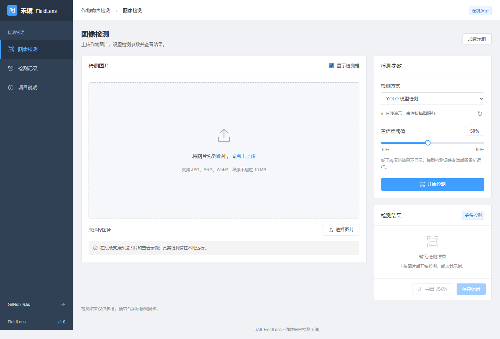
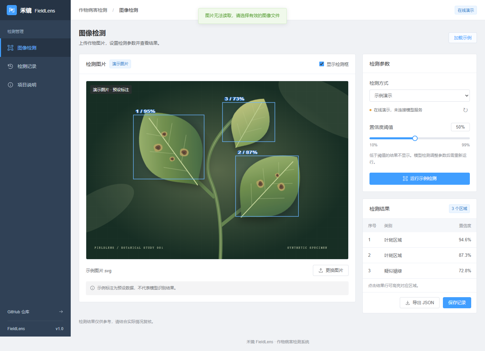
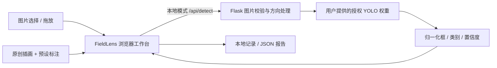

<div align="center">


# 禾镜 FieldLens

**作物病害图像检测系统**

图片检测 · 结果可视化 · 检测记录 · 本地 YOLO 服务

[在线体验](https://guhang2011.github.io/fieldlens/) · [快速开始](#快速开始) · [YOLO 接入](#接入真实-yolo-检测) · [来源与许可](docs/PROVENANCE.md)


</div>



<details>
<summary>查看示例检测结果</summary>



</details>

## 项目介绍

禾镜 FieldLens 将图片、检测框、置信度与巡检记录组织在同一个工作台中，为作物叶片的辅助筛查提供可复核的视觉界面。它适合计算机视觉课程展示、农业视觉原型验证和个人项目作品集。

本项目参考提供的作物病害检测项目的**业务场景**，重新实现前端与图片推理接口。界面参考 Element UI 的常见后台布局，采用蓝色主操作、标准表单和结果列表。样式独立实现，没有引入 Element UI / Element Plus 组件库。

**在线页面是交互演示，点击“加载示例”后使用原创合成插画与固定标注，不进行真实推理，不代表检测精度。** 本地模式可接入自己有权使用的 Ultralytics YOLO 目标检测权重，实际类别和效果取决于模型训练情况。普通 COCO 权重不能替代作物病害模型。

## 功能

| 能力 | 当前版本 |
| --- | --- |
| 原创视觉与品牌 | 标准后台布局、响应式表单与结果列表，示例插画按需加载 |
| 图像导入 | JPG / PNG / WebP；选择或拖放；10 MB / 2500 万像素限制 |
| 图形化 YOLO 检测 | 本地 Python API，归一化检测框，自动处理 EXIF 方向 |
| 结果复核 | 显示/隐藏标注、结果行高亮、置信度筛选、无结果状态 |
| 记录与导出 | 最多 30 条浏览器本地记录；JSON 导出；演示来源标识 |
| 在线展示 | 无需数据库或模型即可体验；GitHub Pages 静态部署 |
| 项目介绍 | 内置「项目说明」页、部署说明、来源说明与验证记录 |

当前版本不包含参考系统的视频检测、摄像头、用户账户、数据库、DeepSeek 咨询等模块。推理输出用于辅助筛查，不能作为确诊或用药依据。

## 快速开始

需要 Node.js 22.12+（建议使用受支持的 LTS 版本）。

```bash
git clone https://github.com/GuHang2011/fieldlens.git
cd fieldlens
npm ci
npm run dev
```

访问终端打印的本地地址。点击「加载示例」后运行示例检测；点击结果行高亮对应框；调整阈值、保存记录或导出 JSON。

```bash
npm test
npm run build
npm run preview
```

生产构建默认是纯静态展示版，不请求推理接口。上传图片在浏览器内预览，不会套用示例标注，也不会上传到 GitHub。

## 接入真实 YOLO 检测

需要 Python 3.12，以及来源和许可明确的 **YOLO 目标检测** 权重。仓库不包含原项目的 `best.pt`、测试图片、数据集、训练产物或数据库。

Windows PowerShell（在仓库根目录）：

```powershell
python -m venv .venv
.\.venv\Scripts\python.exe -m pip install -r server/requirements-yolo.txt
$env:FIELDLENS_MODEL = 'D:\your-authorized-models\crop-detect.pt'
.\.venv\Scripts\python.exe -m server.app
```

macOS / Linux：

```bash
python3 -m venv .venv
.venv/bin/python -m pip install -r server/requirements-yolo.txt
FIELDLENS_MODEL=/absolute/path/crop-detect.pt .venv/bin/python -m server.app
```

另开终端运行 `npm run dev`。前端通过 Vite 将 `/api` 代理到 `http://127.0.0.1:5050`。上传真实图片后，点击「开始 YOLO 检测」。首次推理需要加载模型，可能较慢；CPU/GPU 选择由 Ultralytics 环境决定。服务不会自动下载缺失权重。

只有自行提供且可信的模型文件才应被加载。模型文件存在不代表模型有效：兼容性在首次推理时检查，错误会在界面和服务日志中显示。

只检查 API、无需安装 PyTorch / YOLO 时：

```powershell
.\.venv\Scripts\python.exe -m pip install -r server/requirements.txt
.\.venv\Scripts\python.exe -m unittest discover -s tests -p "test_*.py" -v
```

接口规范、生产部署要求见 [部署与 API](docs/DEPLOYMENT.md)。

## 架构



```text
src/                  原创界面、样式、结果校验与记录逻辑
public/               原创 SVG 标志与植物插画
server/               本地图片推理服务与依赖
tests/                前端数据逻辑与后端接口测试
docs/                 截图、部署文档、来源许可与验证记录
.github/workflows/    持续集成与 Pages 展示部署
```

## 数据与隐私

演示完全在浏览器运行；真实检测仅在点击检测后将所选图片发往配置的同源本地 API。后端在内存中处理图像，不保存上传图片。记录仅包含文件名、时间、阈值和结果，保存在当前浏览器；不会跨设备同步。共享电脑上可使用「清空记录」。

## 来源与许可证

源代码与原创 SVG 使用 **AGPL-3.0-only**，见 [LICENSE](LICENSE)。使用、修改和通过网络提供服务时，请遵守完整许可证，包括相应的源码提供义务。第三方软件遵循其各自许可证；Ultralytics 使用 AGPL-3.0 或另行取得的商业许可。

原项目仅作为业务场景参考；其授权不完整的业务源码、图片、模型和数据库未进入本仓库。详见 [PROVENANCE.md](docs/PROVENANCE.md) 和 [THIRD_PARTY_NOTICES.md](THIRD_PARTY_NOTICES.md)。改名或换 UI 本身不改变版权归属，本项目也不提供“绝无版权纠纷”的保证；名称尚未进行商标检索。

## 验证与后续方向

已提供功能测试和 GitHub Actions CI。具体测试范围及未验证项见 [验证记录](docs/VALIDATION.md)。目前不发布 mAP、准确率或模型性能指标；后续可基于有授权的田间数据补充模型评估、批量任务和视频检测。

---

**FieldLens — A visual crop inspection workspace.** Original interface and synthetic botanical artwork, optional local YOLO inference, transparent demo labeling, and exportable inspection records. The online demo does not perform model inference. Bring an authorized crop detection model for real predictions.
