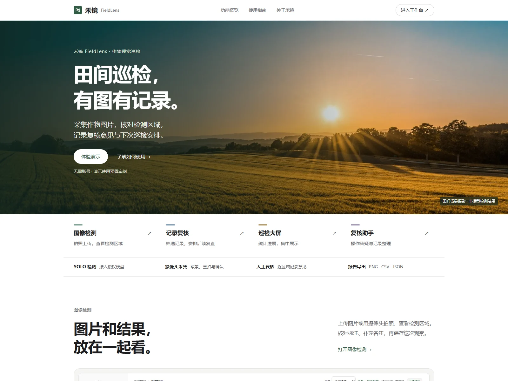
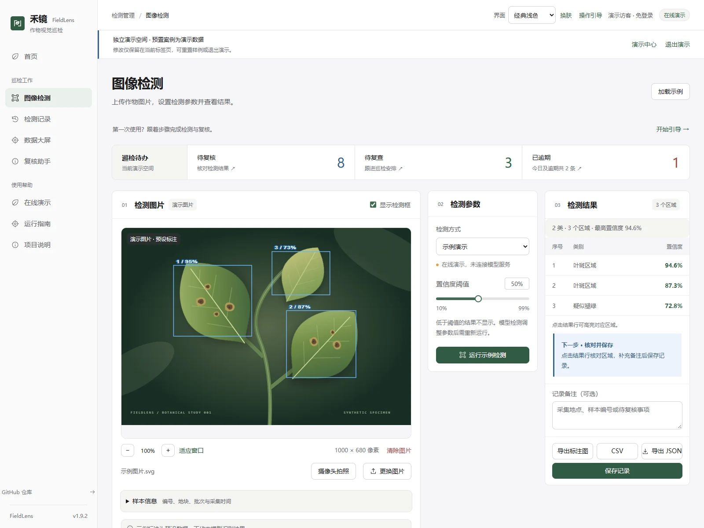
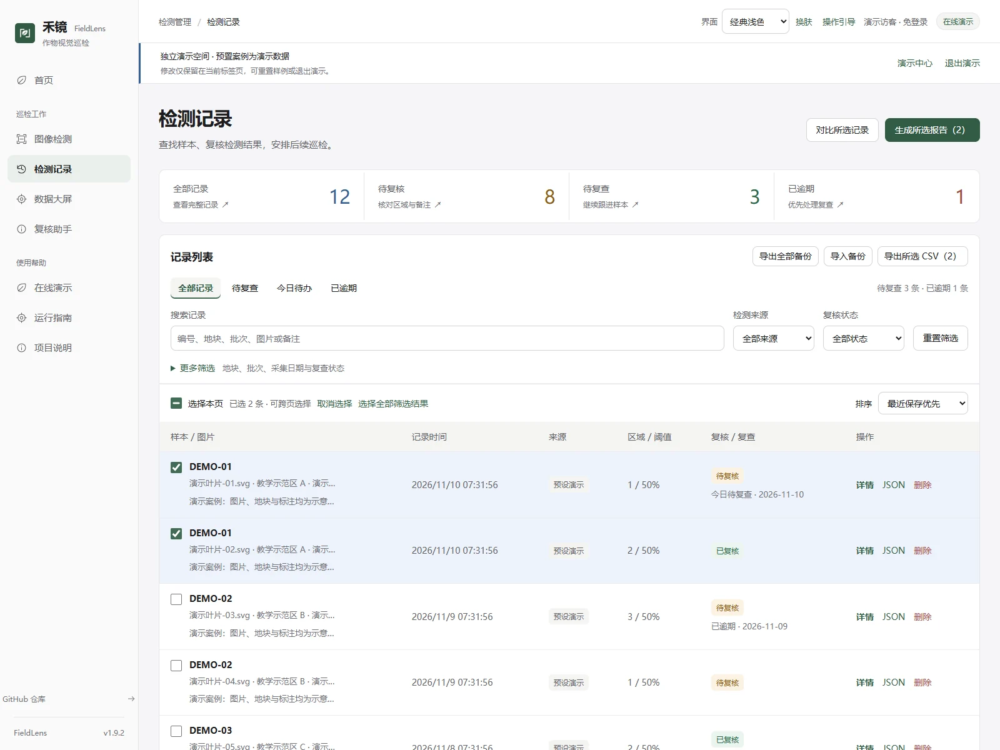
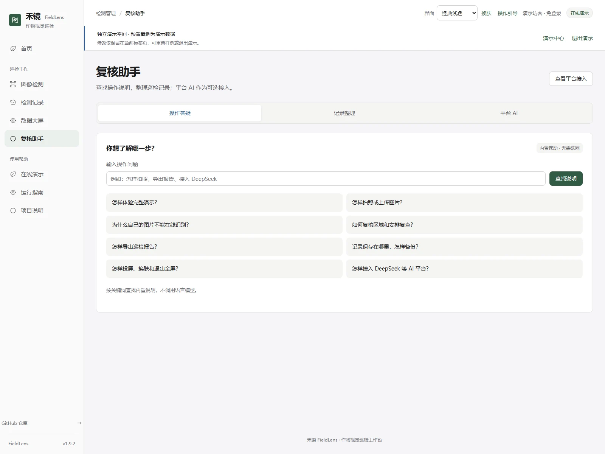
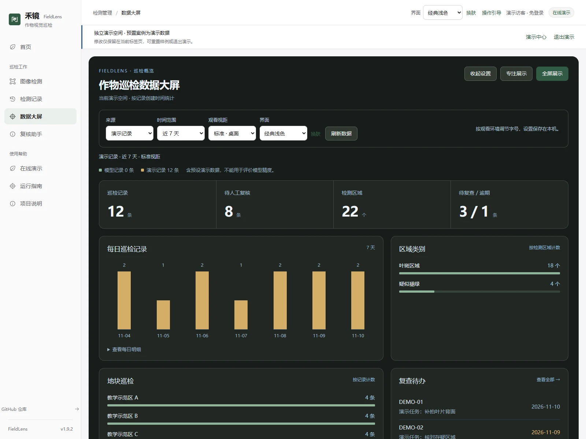
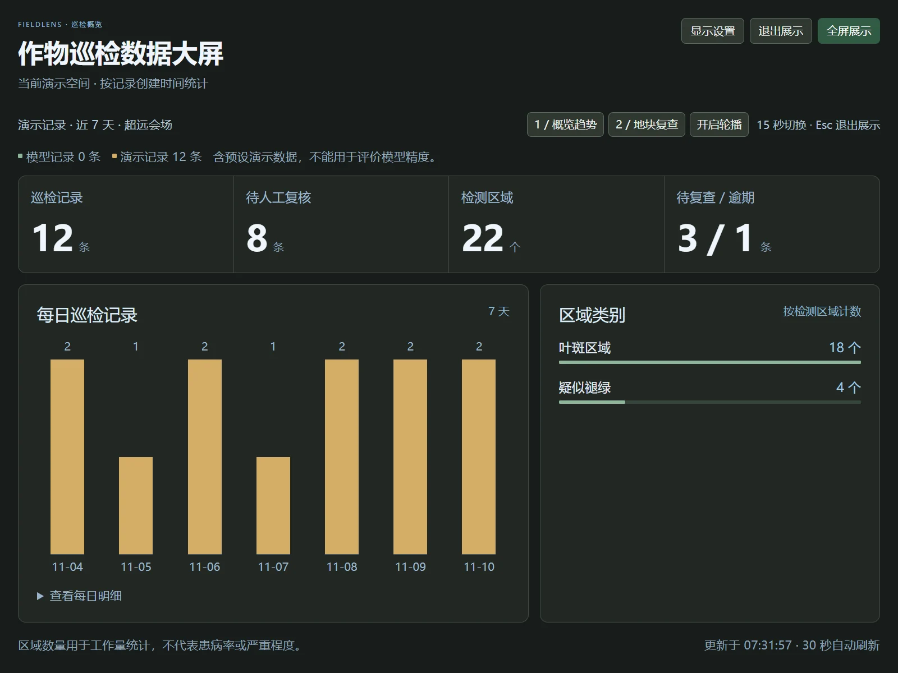
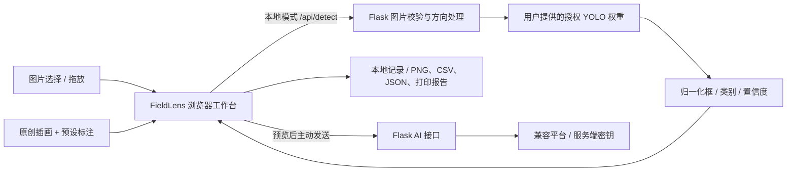

<div align="center">


# 禾镜 FieldLens

**作物病害图像检测系统**

拍照检测 · 界面换肤 · 区域复核 · 账号登录 · 巡检大屏 · 复核助手（可选平台 AI）

[产品首页](https://guhang2011.github.io/fieldlens/?v=1.9.2) · [完整在线演示](https://guhang2011.github.io/fieldlens/?demo=1#demo) · [作品展示](https://guhang2011.github.io/cases/fieldlens/) · [界面设计](docs/PRODUCT_DESIGN.md) · [快速开始](#快速开始) · [YOLO 接入](#接入真实-yolo-检测) · [AI 平台接入](docs/AI_PLATFORM.md) · [来源与许可](docs/PROVENANCE.md)


</div>

[](https://guhang2011.github.io/fieldlens/?v=1.9.2)

当前公开版本 v1.9.2，截图更新于 2026-11-10。下方业务截图使用预置演示案例；点击图片可查看原图。

<details>
<summary>查看检测工作台、记录管理与复核助手</summary>

### 检测工作台

预置案例与固定标注，仅展示检测、缩放及复核流程。

[](docs/screenshots/v1.9.2-20261110/workspace.webp)

### 检测记录

12 条演示巡检记录，支持待办入口、筛选标签、排序与跨页勾选。截图选中两条记录，报告、CSV 与对比使用所选范围。

[](docs/screenshots/v1.9.2-20261110/records.webp)

### 复核助手

截图展示内置操作答疑，不调用语言模型；记录整理采用本地规则，平台 AI 为可选接入。

[](docs/screenshots/v1.9.2-20261110/assistant.webp)

</details>

## 项目介绍

禾镜 FieldLens 将图片、检测框、置信度与巡检记录组织在同一个工作台中，为作物叶片的辅助筛查提供可复核的视觉界面。它适合计算机视觉课程展示、农业视觉原型验证和个人项目作品集。

本项目参考提供的作物病害检测项目的**业务场景**，重新实现前端与图片推理接口。v1.9.0 采用农业场景首页与简洁的业务布局，统一字号、表格、表单及多色状态。正文和操作以 14–16px 为主，保留浅色、青绿、深色与暖砂主题。宽屏显示图片、参数、结果三列；手机记录采用卡片，详情分为区域复核、样本信息、复查安排和 AI 辅助四个标签，保存区固定显示。样式独立实现，没有引入组件库。参考与验证见 [界面设计](docs/PRODUCT_DESIGN.md)。

v1.9.2 参考 Linear 的筛选方式与 Ant Design 的表格选择交互，增加可移除的筛选标签、记录排序、跨页勾选及明确的报告范围。工作台待办可直接进入对应记录，宽屏并排显示图片、参数和结果，保存后提示下一步。默认保留最近保存顺序；排序不改动原记录。

v1.9.1 补充首页使用问答，统一“复核助手”入口。手机端操作答疑直接展示搜索，记录选择只在整理记录或平台提问时显示；切换标签保留当前问题和整理结果。DeepSeek 等兼容平台接口继续保留。

**在线页面是交互演示，点击“加载示例”后使用原创合成插画与固定标注，不进行真实推理，不代表检测精度。** 本地模式可接入自己有权使用的 Ultralytics YOLO 目标检测权重，实际类别和效果取决于模型训练情况。普通 COCO 权重不能替代作物病害模型。

## 完整在线演示

**演示地址：[打开禾镜演示中心](https://guhang2011.github.io/fieldlens/?demo=1#demo)。无需账号、密码或安装。**

预置 12 条记录、3 个示意地块和最近一周的案例，覆盖待复核、复查待办、逾期、已完成和空结果。可以直接体验图像检测、区域复核、记录对比、报告导出和全屏大屏。

演示使用当前标签页的独立记录空间，支持重置。退出演示返回本机记录，不会把案例写入原有个人/账号记录。预置图像和标注均为合成演示数据；自己的照片可预览，真实识别仍需模型服务，公开页不调用 YOLO 或 AI 平台。详见 [演示说明与验证](docs/ONLINE_DEMO.md)。

## 功能

| 能力 | 当前版本 |
| --- | --- |
| 视觉与品牌 | 农业场景首页、清晰的业务导航、分级字号与多色状态，四套主题 |
| 图像导入 | JPG / PNG / WebP；选择或拖放；10 MB / 2500 万像素限制 |
| 摄像头拍照 | 实时预览、摄像头选择、拍照确认与重拍；系统相机 / 照片回退 |
| 图形化 YOLO 检测 | 本地 Python API，归一化检测框，自动处理 EXIF 方向 |
| 结果复核 | 50%–300% 缩放、图片尺寸、标注开关与高亮、置信度筛选 |
| 记录管理 | 最多 30 条本地记录，满额停止新增；搜索、筛选、分页、详情与单条删除 |
| 样本与批次 | 编号、作物、地块、巡检批次、采集时间；地块/批次/日期筛选 |
| 复查待办 | 复查原因、计划日期、处理说明、关联记录；今日/逾期待办与完成/取消状态 |
| 备份恢复 | 完整 JSON 备份、单条报告导入、预览校验、去重与逐条冲突选择 |
| 逐区域复核 | 待确认、保留、疑似误检及说明；保留原始检测数据 |
| 两次记录对比 | 样本属性、位置示意、区域数量和复核状态；模型/阈值/来源差异提示 |
| 巡检报告 | 所选记录或全部筛选结果汇总、演示与模型分组、学院/课程字段、浏览器打印为 PDF |
| 复核助手 | 独立页面；操作说明检索、复核清单、近 7 天概览、TXT 导出，接入平台后可针对记录提问 |
| AI 平台 | 服务端兼容 Chat Completions，可接 DeepSeek 等；文字预览、复核摘要、TXT 导出 |
| 结果导出 | 标注 PNG、CSV、JSON；筛选记录导出；演示来源标识 |
| 操作反馈 | 重复保存保护、清除图片、取消等待、服务状态与运行指南 |
| 用户登录 | 管理员命令行开通账号、服务端验证、会话撤销；公开站点提供演示入口 |
| 数据大屏 | 近 7 / 30 天记录、三档视距、专注展示、双屏轮播及全屏 |
| UI 换肤 | 经典浅色、田野青绿、深色、暖砂及跟随系统；可视预览、恢复默认、本机记忆与跨标签同步 |
| 引导助手 | 六步操作说明、位置定位、完成状态和随时重看，无需 AI 配置 |
| 在线展示 | 免登录演示中心、12 条预置案例、独立空间、重置与分享；GitHub Pages 静态部署 |
| 项目介绍 | 内置「项目说明」页、部署说明、来源说明与验证记录 |

当前版本支持摄像头拍照后检测，不包含连续视频检测或巡检记录云同步。SQLite 只保存可选认证的账号与会话，巡检记录仍在浏览器。AI 辅助通过独立实现的通用平台接口接入，不使用参考系统的代码或密钥。推理输出用于辅助筛查，不能作为确诊或用药依据。

## 快速开始

需要 Node.js 22.12+（建议使用受支持的 LTS 版本）。

```bash
git clone https://github.com/GuHang2011/fieldlens.git
cd fieldlens
npm ci
npm run dev
```

访问终端打印的本地地址。点击「加载示例并查看」体验预设标注；缩放图片、调整阈值、填写备注，再保存记录或导出 PNG / CSV / JSON。检测记录页可搜索、筛选和填写复核意见。

```bash
npm test
npm run build
npm run preview
```

生产构建默认是纯静态展示版，不请求推理接口。上传图片在浏览器内预览，不会套用示例标注，也不会上传到 GitHub。

## 换肤与拍照

右上角点击「换肤」，可预览四种配色，或选择「跟随系统」。切换立即生效并记住选择，不清空图片、记录或表单草稿；可一键恢复默认。

图像检测页点击「摄像头拍照」，允许浏览器访问后取景，点击「拍照」并确认「使用这张照片」。支持重拍和摄像头选择；拍照完成、关闭或离开页面会释放设备。照片只在确认后放入工作台，点击「开始检测」才发送到已配置的本地 YOLO 服务，公开静态页仅支持预览。

摄像头需要 HTTPS 或 localhost 及设备授权；不支持直接预览时，可用「系统相机 / 选择照片」。手机浏览器支持情况有差异。操作、限制和合成媒体测试截图见 [换肤与拍照说明](docs/CAMERA_AND_SKINS.md)。

## 复核助手

[直接体验助手](https://guhang2011.github.io/fieldlens/?demo=1#assistant)。侧栏「复核助手」提供三个入口：操作答疑搜索内置说明；记录整理生成复核清单与近 7 天概览；平台 AI 对接服务端配置的 DeepSeek 等兼容接口。

公开演示可直接使用前两项，并明确标注内置帮助或本地规则，不伪装为模型回答。平台 AI 保留发送预览、取消等待与 TXT 导出，选中记录、刷新快照或离页会清除当前回答，迟到响应不会显示到新记录。详见 [助手说明与截图](docs/AI_ASSISTANT.md)。

## 接入真实 YOLO 检测

需要 Python 3.12，以及来源和许可明确的 **YOLO 目标检测** 权重。仓库不包含原项目的 `best.pt`、测试图片、数据集、训练产物或数据库。

Windows PowerShell（在仓库根目录）：

```powershell
python -m venv .venv
.\.venv\Scripts\python.exe -m pip install -r server/requirements-yolo.txt
$env:FIELDLENS_MODEL = 'D:\your-authorized-models\crop-detect.pt'
.\.venv\Scripts\python.exe -m server.app
```

macOS / Linux：

```bash
python3 -m venv .venv
.venv/bin/python -m pip install -r server/requirements-yolo.txt
FIELDLENS_MODEL=/absolute/path/crop-detect.pt .venv/bin/python -m server.app
```

另开终端运行 `npm run dev`。前端通过 Vite 将 `/api` 代理到 `http://127.0.0.1:5050`。上传真实图片后，点击「开始检测」。首次推理需要加载模型，可能较慢；CPU/GPU 选择由 Ultralytics 环境决定。服务不会自动下载缺失权重。

只有自行提供且可信的模型文件才应被加载。模型文件存在不代表模型有效：兼容性在首次推理时检查，错误会在界面和服务日志中显示。

只检查 API、无需安装 PyTorch / YOLO 时：

```powershell
.\.venv\Scripts\python.exe -m pip install -r server/requirements.txt
.\.venv\Scripts\python.exe -m unittest discover -s tests -p "test_*.py" -v
```

可选接入 DeepSeek 等文字平台，配置与发送范围见 [AI 平台接入](docs/AI_PLATFORM.md)。AI 与 YOLO 独立，未配置平台也能使用检测和记录功能。

接口规范、生产部署要求见 [部署与 API](docs/DEPLOYMENT.md)。

## 账号、大屏与操作引导

管理员在服务器执行 `python -m server.users create inspector --name 巡检员` 创建账号，并设置 `FIELDLENS_AUTH_ENABLED=true` 启用后端验证。没有默认账号或公开注册。HTTPS 部署需设置 `FIELDLENS_COOKIE_SECURE=true`；账号命令与服务使用同一个数据库路径。

GitHub Pages 的「登录」页明确提供演示入口，不验证账号或收集密码。真实登录需要部署同源 Python 服务。登录后按账号区分本机记录，记录不会自动跨设备同步，也不会自动迁移访客记录。配置、备份迁移和会话说明见 [账号与展示功能](docs/ACCOUNTS_AND_SCREEN.md)。

左侧「数据大屏」可查看趋势、类别、地块和复查任务，支持近 7 / 30 天、来源筛选及全屏；右上角「操作引导」可重看六步流程。大屏不会自动生成假数据，引导也不会调用 AI。

[](docs/screenshots/v1.9.2-20261110/dashboard.webp)

演示记录汇总；区域数量不代表患病率或模型精度。

## 大屏视距与 UI 切换

右上角「界面」可选择经典浅色、田野青绿或深色，工作台、记录、登录和弹窗一起切换，当前输入不会清空。大屏设置里也有主题入口，可在全屏状态下使用。

数据大屏的「观看视距」提供标准桌面、远距投屏、超远会场三档。点击「专注展示」隐藏主导航，分为概览趋势和地块复查两屏；可手动切换，或开启每 15 秒轮播。Esc /「退出展示」恢复工作界面。字号、来源和日期设置在本机记忆，专注与轮播需手动开启。

[](docs/screenshots/v1.9.2-20261110/presentation.webp)

具体操作与截图见 [大屏展示和主题说明](docs/PRESENTATION.md)。

## 架构



```text
src/                  原创界面、样式、结果校验与记录逻辑
public/               原创 SVG 标志与植物插画
server/               本地图片推理服务与依赖
tests/                前端数据逻辑与后端接口测试
docs/                 截图、部署文档、来源许可与验证记录
.github/workflows/    持续集成与 Pages 展示部署
```

## 数据与隐私

启用认证后，密码哈希和会话摘要保存在服务端 SQLite，使用 HttpOnly 会话 Cookie。浏览器记录按账号 ID 分组，但不加密；共享设备上能访问浏览器数据的人仍可读取。退出不会删除本机记录，跨设备需手动备份恢复。

演示完全在浏览器运行；真实检测仅在点击检测后将所选图片发往配置的同源本地 API。后端在内存中处理图像，不保存上传图片。记录包含文件名、时间、尺寸、阈值、结果、备注与复核状态，不保存原图，保存在当前浏览器；不会自动跨设备同步，可手动导出备份并在另一台设备导入。复查提醒仅在打开站点时显示。共享电脑上可使用「清空记录」。AI 只有在用户发送预览内容后才会经服务端调用配置的平台；发送文字记录及坐标，不自动附带图片与样本位置等字段。密钥只保留在服务端，AI 回答不会自动改写记录。

## 来源与许可证

源代码与原创 SVG 使用 **AGPL-3.0-only**，见 [LICENSE](LICENSE)。使用、修改和通过网络提供服务时，请遵守完整许可证，包括相应的源码提供义务。第三方软件遵循其各自许可证；Ultralytics 使用 AGPL-3.0 或另行取得的商业许可。

原项目仅作为业务场景参考；其授权不完整的业务源码、图片、模型和数据库未进入本仓库。详见 [PROVENANCE.md](docs/PROVENANCE.md) 和 [THIRD_PARTY_NOTICES.md](THIRD_PARTY_NOTICES.md)。改名或换 UI 本身不改变版权归属，本项目也不提供“绝无版权纠纷”的保证；名称尚未进行商标检索。

界面参考与适配记录见 [Element 风格统一](docs/UI_REFERENCE.md)。

## 验证与后续方向

v1.5 新增三种主题、三档大屏视距、专注分屏及可暂停的轮播。检查 360px 手机到 3840px 4K 布局，保留登录、YOLO、备份、报告和 AI 平台接口，见 [验证与截图](docs/PRESENTATION.md)。

v1.4 新增管理员开通账号、巡检数据大屏和操作引导。27 项前端、21 项后端测试以及真实本地登录与原有浏览器流程回归通过，见 [功能与部署说明](docs/ACCOUNTS_AND_SCREEN.md)。

v1.3.1 整理了工作台、记录列表和详情分区，补充手机卡片及键盘操作，见 [界面优化与验证](docs/UI_REFINEMENT.md)。

v1.3 已实现逐区域复核、记录数据对比、打印报告和通用 AI 接口，见 [1.3 功能说明](docs/INSPECTION_RELEASE.md)。v1.2 的备份恢复、样本批次和复查待办继续保留。[后续规划](docs/PRACTICAL_FEATURES.md) 中的缩略图存储、原图对比和批量检测尚未实现。

已提供功能测试和 GitHub Actions CI。具体测试范围及未验证项见 [验证记录](docs/VALIDATION.md)。目前不发布 mAP、准确率或模型性能指标；后续可基于有授权的田间数据补充模型评估、批量任务和视频检测。

---

**FieldLens — A visual crop inspection workspace.** Original interface and synthetic botanical artwork, optional local YOLO inference, transparent demo labeling, and exportable inspection records. The online demo does not perform model inference. Bring an authorized crop detection model for real predictions.


v1.6 增加可视换肤面板、暖砂与跟随系统，以及摄像头取景、重拍和照片确认。摄像头以合成媒体完成自动化验证，未实测实体手机或摄像头；见 [验证记录](docs/CAMERA_AND_SKINS.md)。


v1.7 增加完整交互演示，31 项前端测试通过；演示空间与个人记录隔离，接入现有复核、报告和大屏。见 [在线演示说明](docs/ONLINE_DEMO.md)。


v1.8 增加独立 AI 助手入口与无需配置的操作帮助、复核清单、巡检概览；保留真实平台接口。34 项前端测试和浏览器流程通过，详见 [验证记录](docs/AI_ASSISTANT.md)。
