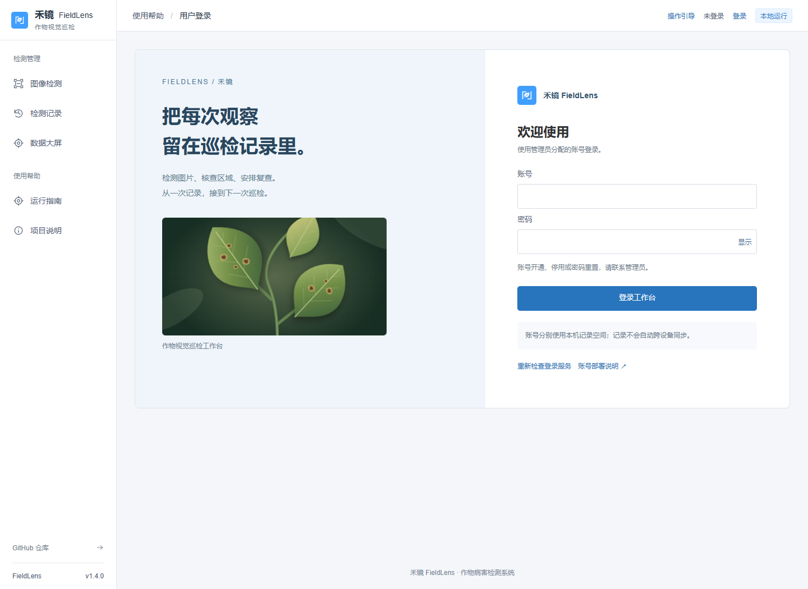
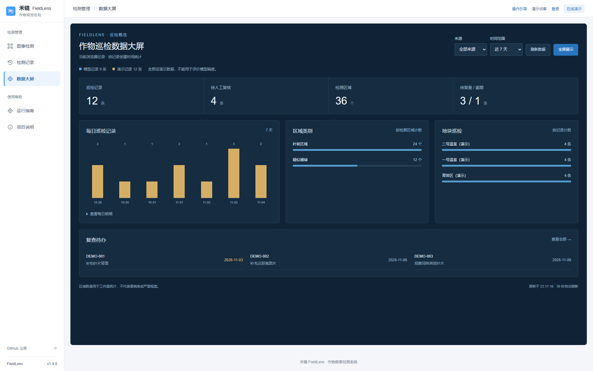
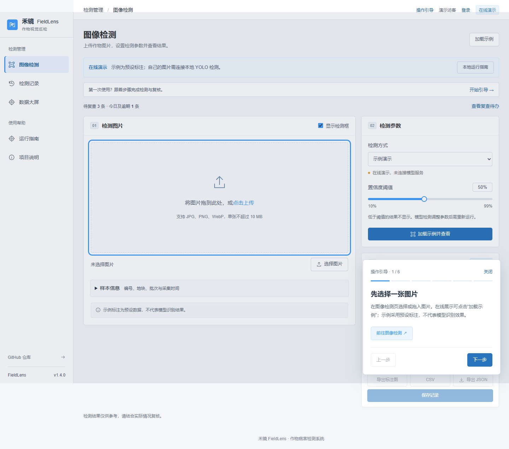

# v1.4：账号登录、数据大屏与操作引导

更新日期：2026-11-04。保留图像检测、记录复核、备份恢复、巡检报告和通用 AI 平台接口。

## 三个入口

- 右上角「登录」：使用管理员开通的账号进入工作台，支持显示/隐藏密码、退出及会话过期后重新登录。
- 左侧「数据大屏」：汇总当前浏览器的巡检记录，可切换来源、近 7 / 30 天，刷新或全屏展示。
- 右上角「操作引导」：从选择图片走到记录复核和 AI 接入，可前后翻页、定位操作位置、关闭和重新查看。首次进入工作台也有入口。



## 演示与真实账号

| 运行方式 | 账号验证 | 数据 |
| --- | --- | --- |
| GitHub Pages | 不验证账号；密码输入与登录提交禁用，提供明确的演示入口 | 当前浏览器的演示/导入记录 |
| 本地默认模式 | 默认未启用，便于单机试用 | 原有本机记录空间 |
| 开启认证的同源部署 | 服务端验证管理员创建的账号；未登录不能访问检测和 AI 接口 | 每个账号使用独立的本机记录键 |

**真实登录需要运行 Python 后端。** GitHub Pages 不运行认证服务，不会接收账号密码。前端不能用写入本地存储的方式伪造登录。

## 管理员创建账号

在仓库根目录执行。只安装基础依赖即可使用认证；需要 YOLO 时再安装 `server/requirements-yolo.txt`。

```powershell
python -m venv .venv
.\.venv\Scripts\python.exe -m pip install -r server/requirements.txt
$env:FIELDLENS_AUTH_ENABLED = 'true'
# 可选：指定不在静态站点目录内的持久化数据库路径
$env:FIELDLENS_AUTH_DB = 'D:\fieldlens-data\accounts.sqlite3'
.\.venv\Scripts\python.exe -m server.users create inspector --name '巡检员'
.\.venv\Scripts\python.exe -m server.app
```

另开终端运行 `npm run dev`，从前端地址打开登录页。命令行会两次提示输入密码，输入不回显；密码需为 12–128 个字符。账号为 3–40 位字母、数字、下划线、点或短横线，首位是字母或数字，不区分大小写。

Linux / macOS 使用 `.venv/bin/python`，环境变量例如 `export FIELDLENS_AUTH_ENABLED=true`。CLI 和服务必须指向同一个 `FIELDLENS_AUTH_DB`；未指定时使用仓库 `instance/accounts.sqlite3`。数据库及其目录需允许服务账号写入。

```powershell
.\.venv\Scripts\python.exe -m server.users list
.\.venv\Scripts\python.exe -m server.users password inspector
.\.venv\Scripts\python.exe -m server.users disable inspector
```

本版没有公开注册或网页账号管理入口，账号由有服务器访问权限的管理员管理。没有内置账号或默认密码。重置密码和停用都会撤销该账号已有会话；重置密码不会自动恢复已停用账号。

## 服务器部署

构建时设置 `VITE_ENABLE_API=true`，让前端连接同源 `/api`。服务端必须设置 `FIELDLENS_AUTH_ENABLED=true`；HTTPS 部署还要设置 `FIELDLENS_COOKIE_SECURE=true`。本地 HTTP 调试保留该变量为 `false`，否则浏览器可能不会发送 Cookie。

使用正式 WSGI 服务并通过 HTTPS 反向代理访问；代理保留浏览器请求的 `Host`，将 `/api/` 转发到应用。例如 Nginx 的 API location：

```nginx
location /api/ {
    proxy_pass http://127.0.0.1:5050;
    proxy_set_header Host $http_host;
}
```

这是 API 转发片段，TLS 和静态目录按实际域名配置。`dist/` 是静态发布目录，SQLite、模型和密钥不得放进去。使用持久化磁盘保存账号库；本方案适合单机/小组部署，不支持多个独立数据库实例自动共享会话。

认证保护 `/api/health`、`/api/detect` 和 AI 接口。写请求要求 `X-FieldLens-Request: 1`，并检查浏览器来源；前端已统一添加，不开放跨域登录。前端仍提供源码入口以满足项目的开源许可要求。

会话最长 8 小时，使用 HttpOnly、SameSite=Lax Cookie；服务端只存会话令牌摘要，密码使用 scrypt 哈希。退出立即撤销当前会话，同源其他标签页会重新检查登录状态。密码重置和停用撤销全部会话。后端按账号或连接 IP 限制 15 分钟内 8 次失败尝试，成功登录不占用失败额度；代理后的多个用户可能共享 IP 限额。部署端还应按实际流量控制推理并发。

## 记录如何保存

SQLite **仅保存账号、会话和登录尝试**，不保存巡检记录。每个账号的记录按服务端生成的账号 ID 分开存入浏览器，每个空间最多 30 条。访客继续使用原来的本机空间，登录时不会自动导入访客记录。

如需迁移，先在原空间导出 JSON 备份，再登录目标账号，在记录页预览并导入。更换浏览器或设备不会自动同步；退出不会删除记录。共享浏览器中的本地存储不是加密保险箱，能访问浏览器数据的人仍可能读取记录。不要把这种界面上的分组理解为服务端数据权限隔离。

## 大屏统计口径



- 按记录创建时间和本机日期统计最近 7 / 30 天，不按样本采集时间。
- 汇总记录数、待人工复核记录、检测区域数、待复查与逾期任务；人工复核和复查完成是两个独立状态。
- 趋势图分开显示模型与演示记录，可筛选单一来源，并展开每日数值明细。
- 类别按区域数、地块按记录数排行，显示前 6 项；复查列表显示当前范围前 5 条，完整待办可进入记录页。
- 页面每 30 秒刷新，也可手动刷新；无数据时显示空状态，不自动填充展示数据。
- 不把区域数解释为患病率、严重程度或模型准确率。截图里的数据均为明确标注的演示样例。

全屏调用浏览器原生能力，不支持的设备会提示使用浏览器全屏。手机按单列排列内容，宽屏使用多列布局。

## 引导助手



六步依次说明图片导入、参数与结果、保存、人工复核与复查、大屏与报告、AI 接入。完成后记住本浏览器的引导状态，右上角可随时重看；Esc 或「关闭」退出。引导仅解释现有操作，不调用 AI、不发送记录，也不自动更改检测数据。

原有 AI 接口独立保留，只有在记录详情中预览并发送后才调用配置的平台，见 [AI 平台配置](AI_PLATFORM.md)。

## 验证

前端 27 项、后端 21 项自动测试及生产构建通过。认证测试包含未登录拦截、错误凭据、限流、会话到期、重置/停用撤销、Cookie 标志及来源校验。浏览器使用临时账号库验证真实登录、退出、账号切换、会话失效后的重新登录及多标签页退出；临时测试账号不随应用发布。

既有四组浏览器流程通过；新增流程覆盖引导关闭/完成/重看、大屏来源与日期筛选、空状态、全屏和 4 页 × 6 种宽度（360–2560px）布局。未部署公开认证后端，也未评估真实模型或 AI 平台效果。

手机截图：[登录](login-mobile.png) · [大屏](dashboard-mobile.png) · [引导](onboarding-mobile.png)。公开入口截图见 [静态演示登录页](login-demo.png)。
