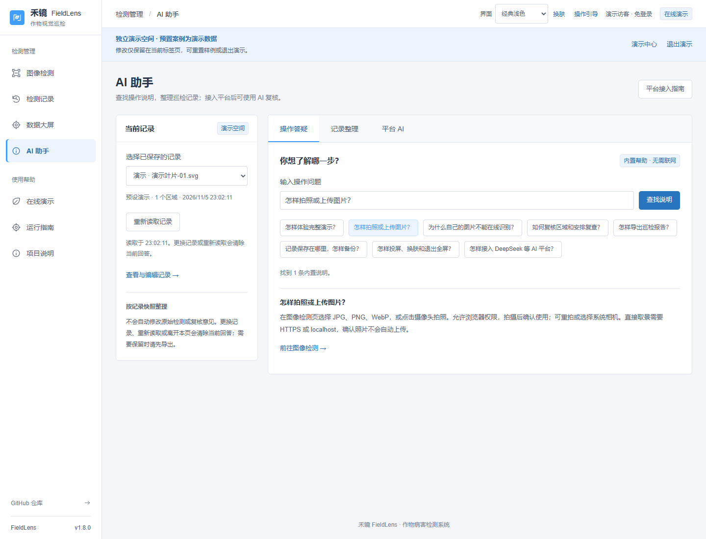
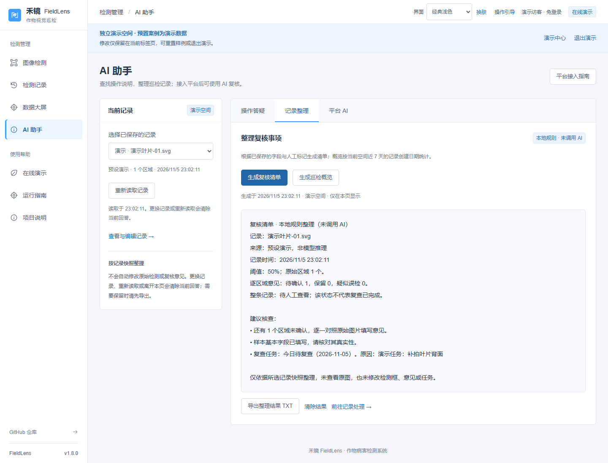
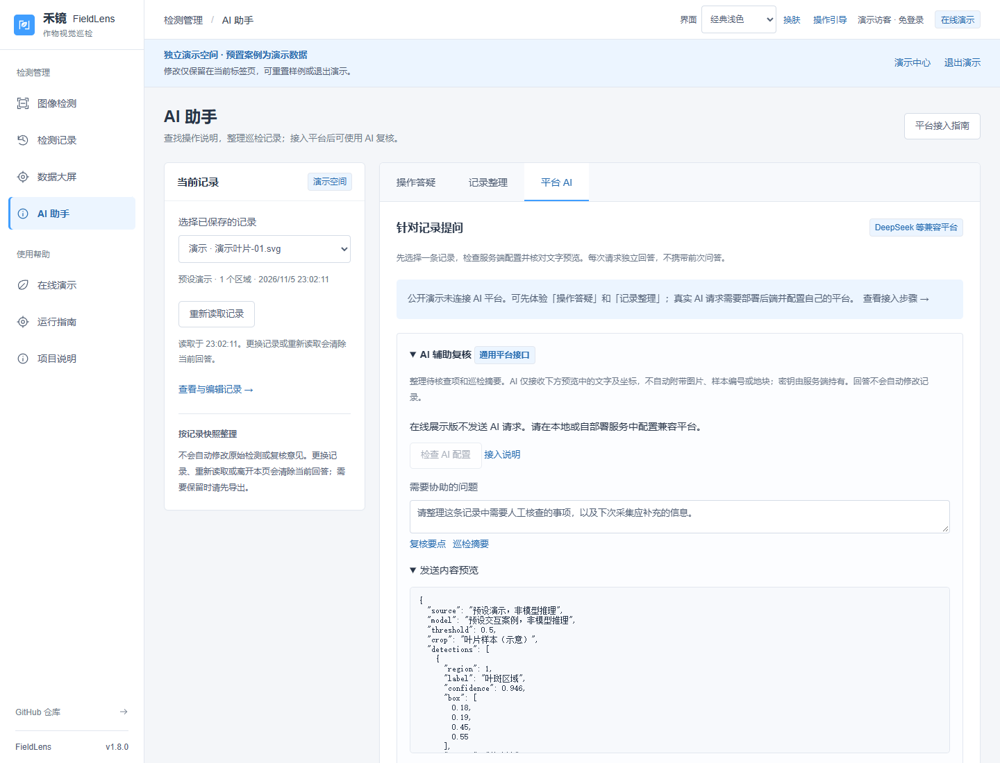

# AI 助手

v1.8.0，2026-11-05。

[打开演示助手](https://guhang2011.github.io/fieldlens/?demo=1#assistant)，无需账号密码。也可以从侧栏「AI 助手」进入。助手沿用当前的个人/账号记录或独立演示空间。

## 三种使用方式

| 入口 | 功能 | 是否调用模型 |
| --- | --- | --- |
| 操作答疑 | 输入关键词查找拍照、检测、复核、报告、备份、大屏与平台接入说明，带页面跳转入口 | 否，内置帮助 |
| 记录整理 | 对选中记录生成复核清单，或汇总当前空间近 7 天巡检记录，可导出 TXT | 否，本地规则 |
| 平台 AI | 针对选中记录提问，整理复核要点或巡检摘要 | 是，需服务端配置兼容平台 |

本地助手按关键词与固定规则工作，不是自由对话模型。未找到操作说明时会明确提示；复核清单只检查已有字段和人工标记，概览按记录创建日期统计并分开演示与模型记录。没有原图，不提供病害确诊或用药剂量，也不会修改记录。

## 平台 AI

先在服务端配置 `FIELDLENS_AI_BASE_URL`、`FIELDLENS_AI_MODEL`、`FIELDLENS_AI_API_KEY`，支持 DeepSeek 等兼容 Chat Completions 的文字接口。详细命令见 [平台接入](AI_PLATFORM.md)。密钥不填写到网页，不随前端发布。

进入平台 AI 后，选择已保存记录，点击「检查 AI 配置」，查看发送内容预览，再发送问题。显示配置齐全并不代表平台调用已验证；每次请求独立，不携带前次问答。发送内容沿用原接口：来源、模型、阈值、作物、检测区域、人工意见、备注与问题，不自动附带原图、文件名、编号、地块或批次。文字备注可能包含自行填写的信息，请核对预览。

GitHub Pages 不含推理后端或公共密钥，平台按钮会明确提示需要配置；可直接体验操作答疑和记录整理。原「记录详情 → AI 辅助」仍保留。

## 快照、取消与导出

助手读取已保存的记录快照。记录在其他标签页更新时，会提示重新读取。切换记录或点击左侧「重新读取记录」会取消等待、清除当前结果，载入新快照；离开页面也会清理请求。已经发给平台的请求可能仍处理并计费。

回答只在当前页面暂存。能力标签之间切换会保留内容；离页、刷新、更换记录后清除。需要保留时导出 TXT，本地整理与 AI 回答的导出都会保留来源标识。回答以普通文字显示，不执行平台返回的 HTML。

左侧记录选择不会保存任何修改，AI 也不会自动更新检测框、复核意见或任务。用户仍需进入记录页核对并保存。

[手机助手](assistant-mobile.png)。截图使用预置演示案例；没有展示真实模型诊断结果。

## 验证范围

34 项前端测试、生产构建、60 组助手布局和浏览器工作流通过。平台接口使用明确的模拟响应验证配置、请求、错误、取消、切换/离页清理、迟到结果、文本安全与导出；没有使用付费密钥进行真实平台调用，没有评估农业诊断能力。

原有记录详情、人工复核、报告、完整演示和大屏回归通过。后端协议、YOLO 和认证逻辑保持原实现。
