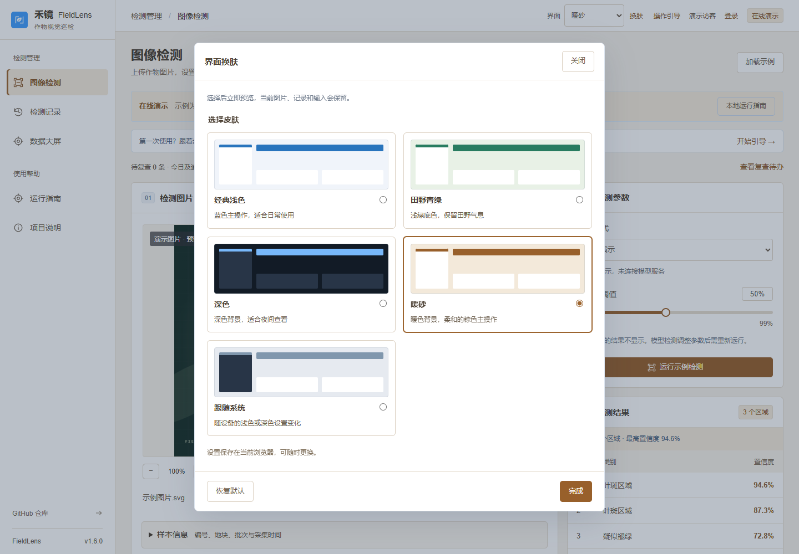
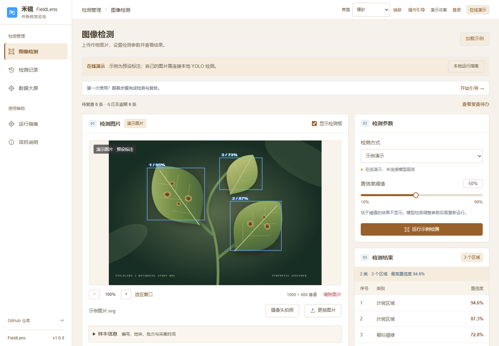
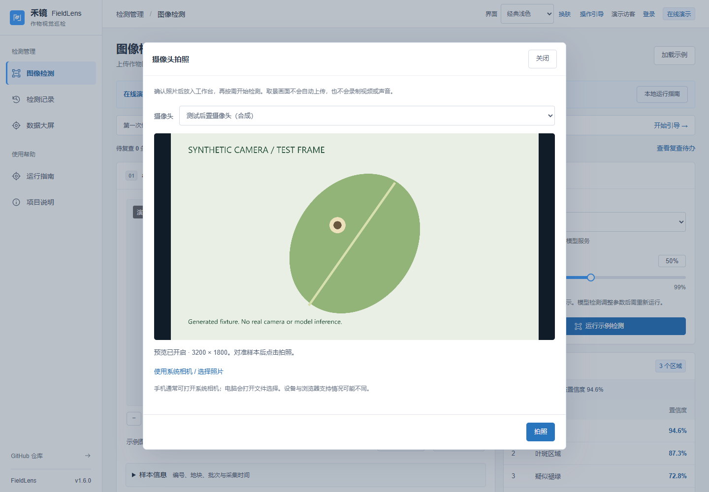
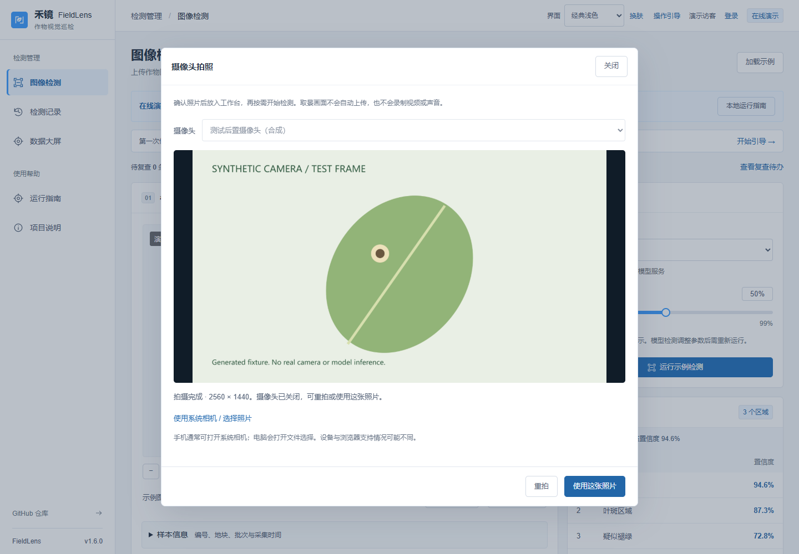

# 换肤与摄像头拍照

v1.6.0，2026-11-04。

## 界面换肤

右上角「换肤」打开预览面板，提供经典浅色、田野青绿、深色、暖砂四种配色，以及随设备深浅设置变化的「跟随系统」。选中即应用，「完成」关闭面板；关闭或 Esc 不撤回已选主题。「恢复默认」切回经典浅色。

设置保存在当前浏览器，同源标签页同步；切换不重新加载页面，不清空当前图片、表单、记录或详情草稿。大屏全屏时可从设置区换肤。打印报告仍使用白底。浏览器禁止存储时仍能切换，刷新后可能恢复默认。

## 摄像头拍照

1. 在「图像检测」页点击「摄像头拍照」，允许当前网站访问摄像头。优先尝试后置摄像头，不请求麦克风。
2. 有多个设备时可用下拉框选择。取景时对准样本，等待画面清晰后点击「拍照」。
3. 查看照片，选择「重拍」或「使用这张照片」。拍照完成即关闭摄像头，重拍会重新开启。
4. 确认后照片进入现有检测工作台。配置本地 YOLO 服务后，手动点击「开始检测」；公开 GitHub Pages 只提供照片预览，不执行推理，也不会套用演示检测框。

照片生成 JPEG，保持宽高比，最长边不超过 2560px，最大 10 MB。取景画面不自动上传、不录制视频或音频。确认照片后，只有点击检测才会通过已有接口上传至配置的服务。关闭窗口、Esc、离开检测页或取景时切到后台都会停止媒体流；迟到的权限结果不会重新打开已关闭的窗口。

实时预览需要 HTTPS 或 localhost、浏览器支持和摄像头授权。拒绝授权后，可在网站权限中重新允许，再点「重新开启」。设备占用、断开或无画面时会给出提示。

「使用系统相机 / 选择照片」会先停止网页预览，再打开设备原生选择器。手机通常提供系统相机，电脑通常选择图片；是否打开相机由系统和浏览器决定。返回照片沿用现有图片验证，不支持的格式会提示重新选择。取消选择后可重新开启网页预览。

## 界面截图

以下摄像头画面为 `tests/browser/camera-fixture.js` 绘制的合成测试帧，文字明确标注 **SYNTHETIC CAMERA / TEST FRAME**。截图不是实体摄像头拍摄，也不代表模型检测结果。

[手机换肤](skin-mobile.png) · [手机拍照](camera-mobile.png)。

## 验证范围

在隔离的 Chromium 浏览器中以 Canvas MediaStream 验证了设备切换、比例与尺寸、照片编码、重拍、确认、媒体释放、迟到权限、错误反馈、原生文件选择回退及模拟 YOLO 上传。拍照弹窗在经典浅色、暖砂、深色下检查了 360、390、768、1920px 四种宽度；手机关闭按钮及拍照/确认按钮保持可见。

换肤检查了四种配色、系统深浅变化、记忆、恢复默认、草稿保留及全屏入口，并检查暖砂/深色下六个页面的四种宽度。原有大屏、详情、区域复核、报告和 AI 模拟流程完成回归。

未实测实体摄像头、实体手机、Safari 或 Firefox；未新增真实 YOLO 模型和 AI 平台效果评估。账号、记录、备份与后端接口未改变。
