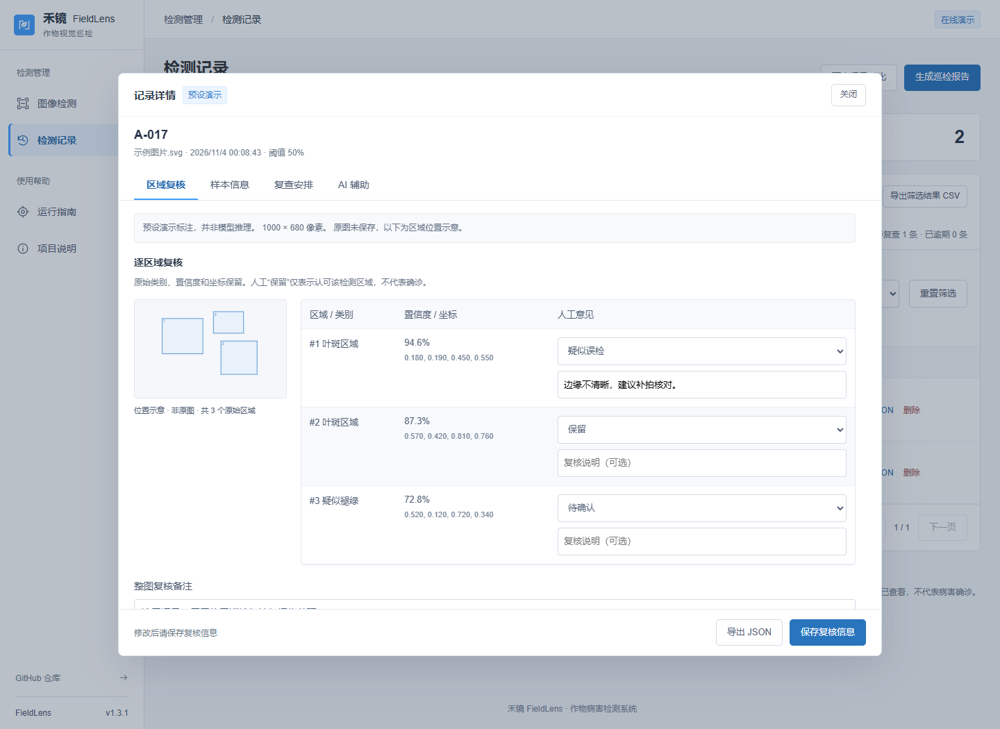
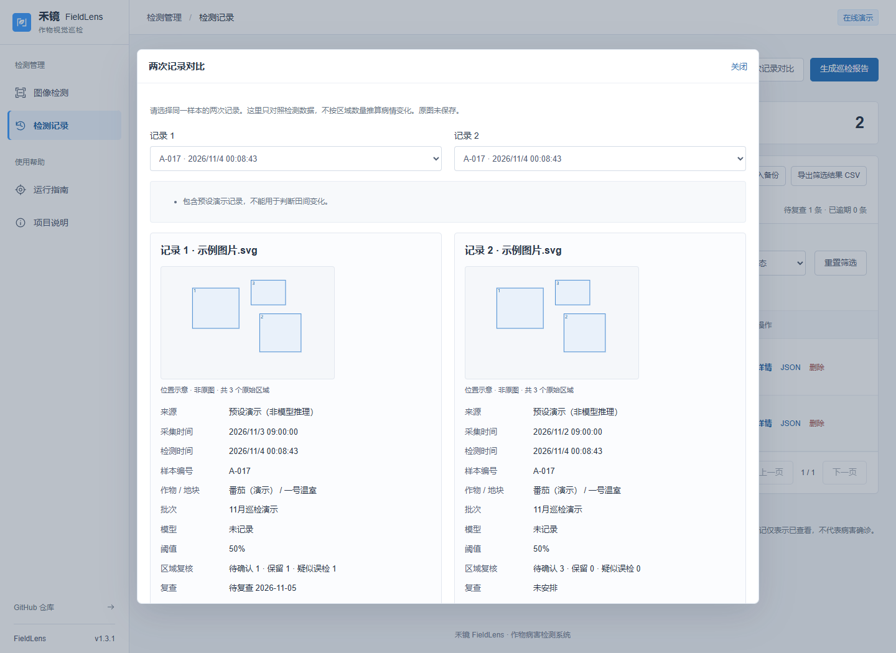
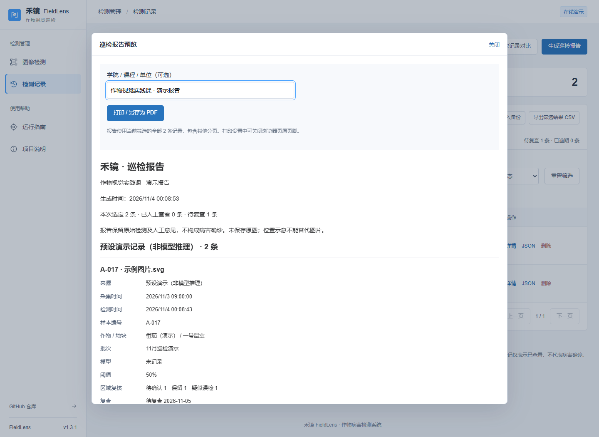
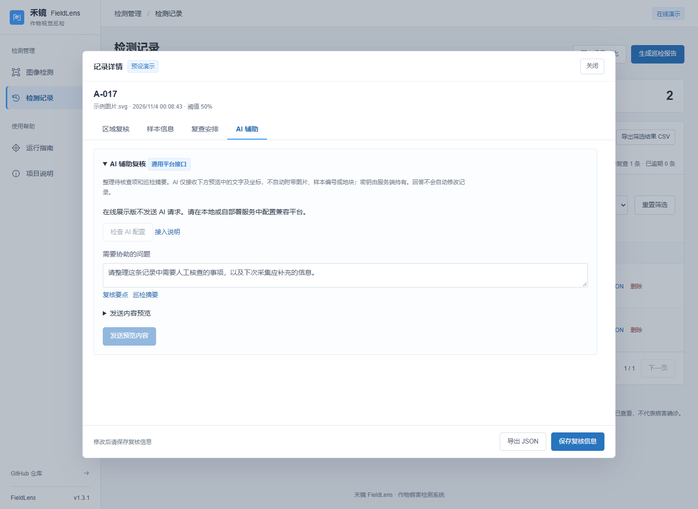

# v1.3：复核、对比、报告与 AI 接口

日期：2026-11-03。

| 使用中的问题 | 本次实现 |
| --- | --- |
| 一条记录“已查看”，但不知道具体哪个框有问题 | 逐区域选择待确认、保留、疑似误检，并填写说明；原始类别、置信度和坐标不改动 |
| 两次巡检难以逐项对照 | 在筛选结果内选两条记录，对照采集时间、样本、作物、地块、阈值、模型及区域数量，提示条件不一致 |
| CSV 不方便在课程或巡检交接中阅读 | 按当前筛选的全部记录生成报告预览，支持填写学院/课程/单位，打印或另存为 PDF |
| 希望继续使用外部 AI 平台，又不想把密钥放在网页 | 保留本地 YOLO，新增服务端通用 Chat Completions 接口，支持 DeepSeek 等平台；发送前显示内容预览 |

## 使用入口

- 检测记录 → 详情 → 区域复核。保存后更新本地记录；JSON、CSV、完整备份和打印报告保留人工意见。
- 检测记录 → 两次记录对比。筛选至少两条记录后启用，可在弹窗内更换比较对象。
- 检测记录 → 生成巡检报告。使用当前筛选的全部记录，包含其他分页。演示记录和模型记录分组标识。
- 检测记录 → 详情 → AI 辅助。在线静态展示保留入口和接入说明，实际调用需本地或自部署服务。配置方法见 [AI 平台接入](AI_PLATFORM.md)。

## 数据规则

区域意见以原始类别、置信度、坐标及重复序号关联，不使用筛选后行号；新的检测记录不继承其他记录的意见。修改工作台备注不会覆盖已保存的区域复核。旧版记录补充空意见，原备份格式继续兼容。

对比提供位置示意和记录数据，没有持久化图片，不构成原图对比；不按检测框数量推断病情改善。人工“保留”不等于确诊，未检出区域不等于健康。

AI 使用发送时的预览快照，只给出文字参考；不自动修改或完成任何任务。回答以普通文本显示，支持单独导出 TXT。关闭详情时取消等待并清除临时回答。

## 验证范围

25 项前端测试、14 项后端测试及生产构建。新增 `tests/browser/inspection-workflow.js` 覆盖复核保存、工作台更新保留意见、来源及条件差异、筛选报告、PDF 生成、静态 AI 入口、模拟请求成功/失败/取消/关闭隔离，以及 360、390、768、1440、1920、2560px 布局。

运行专项浏览器检查需先启动生产预览 `npm run preview -- --port 4176` 和开发服务 `npm run dev -- --port 5176`，通过 Playwright CLI 执行 `run-code --filename tests/browser/inspection-workflow.js`。使用隔离浏览器上下文，平台请求均为明确模拟。

未实现或未验证：图片持久化及原图对比、批量推理、浏览器关闭后的通知；真实农业模型精度、付费 AI 平台实际调用效果。现有 30 条容量保护、备份恢复和复查流程继续保留。

## 界面截图

以下均为预设演示记录，不展示模拟模型或虚构 AI 回答。

