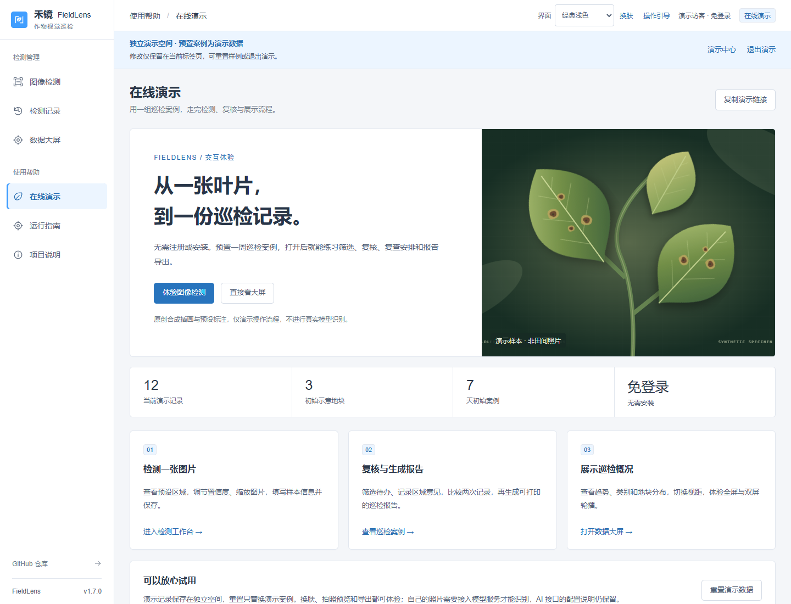
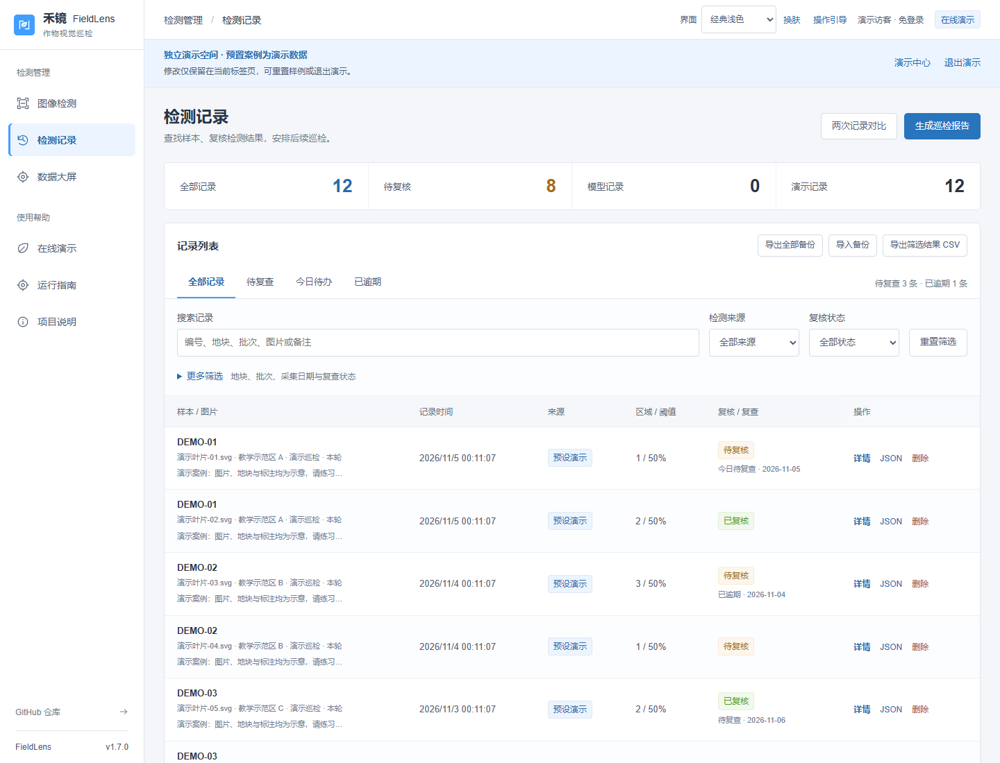
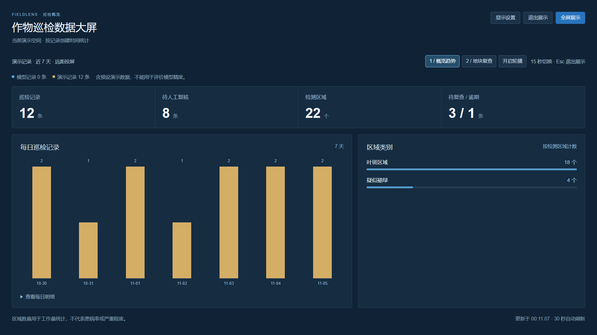

# 完整在线演示

v1.7.0，2026-11-05。

**地址：[禾镜演示中心](https://guhang2011.github.io/fieldlens/?demo=1#demo)。账号与密码：不需要。**

打开链接会进入独立演示空间。也可从原工作台的「完整交互演示」或侧栏「在线演示」进入，再选择体验项目。公开网页不会收集或验证密码。

## 推荐体验顺序

1. **图像检测**：点击「体验图像检测」，加载原创合成叶片。调整置信度、缩放、隐藏标注，填写备注后保存记录。
2. **巡检复核**：查看 12 条预置案例。使用今日待办或地块筛选，打开详情标记区域意见和复查安排；保存后可比较两次记录。
3. **巡检报告**：在记录页点击「生成巡检报告」，核对筛选结果，填写学院/课程名称，再通过浏览器打印或保存为 PDF。报告保留演示来源。
4. **数据大屏**：查看近一周记录、类别和地块分布，试用视距、专注展示、全屏和轮播。大屏读取当前演示记录，保存或修改后可以继续查看。

换肤和摄像头预览仍可使用。拍摄自己的照片不会自动获得演示检测框，公开页面不执行模型推理；真实 YOLO 和 AI 平台的接入说明在运行指南中。

所有截图均为合成插画与预置案例，不代表真实田间数据、病害诊断或模型精度。[手机演示中心](demo-mobile.png)。

## 数据与退出

演示记录使用独立的标签页暂存空间，不写入个人或账号的本机记录。刷新通常保留已保存的演示修改；关闭标签页后不保证保留，长期保存应导出备份。浏览器禁止暂存时改用内存，并显示刷新可能丢失的提示。

「重置演示数据」会先确认，只替换当前演示记录，重新生成相对当前日期的一周案例。主动清空后不会在刷新时重新填充，需手动重置。

「退出演示」回到本机记录；如果从当前工作区进入且未刷新，还会还原进入前的图片和未保存草稿。分享按钮只复制公开入口，不包含照片、记录或修改。另一个标签页独立操作，不实时同步；浏览器复制标签页时可能复制该时刻的暂存内容。

初始数据包括 12 条演示记录、3 个示意地块，待复核/已复核、今日/逾期/未来复查、已完成/取消和空结果案例。所有记录都标记为预设演示。初始化不需要数据库或模型服务。

## 验证

31 项前端逻辑测试、生产构建和浏览器流程验证通过。新增流程覆盖个人记录隔离、图片与草稿还原、复核和报告、清空/刷新/重置、存储受限、前进后退和分享。四种主题、四个页面及五种宽度共 80 组布局验证通过。

启用后端的部署不会因为演示 URL 而跳过登录，演示中心会提供公开静态演示链接。账号验证、模型服务和 AI 接口沿用原有功能；本轮没有部署公开认证或推理后端。
