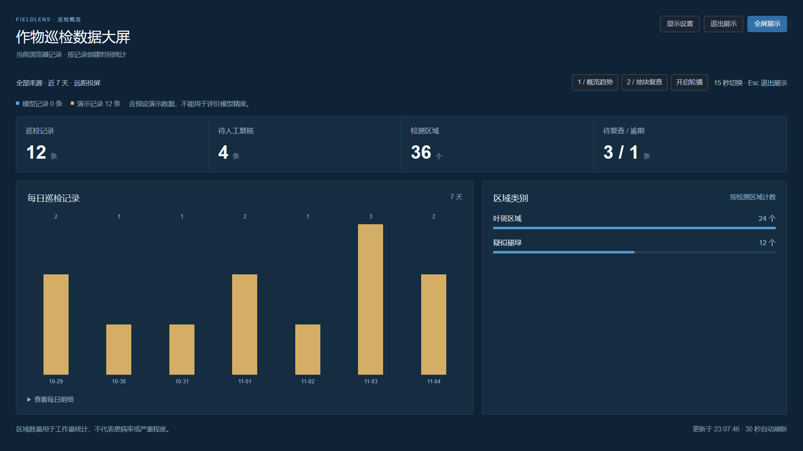
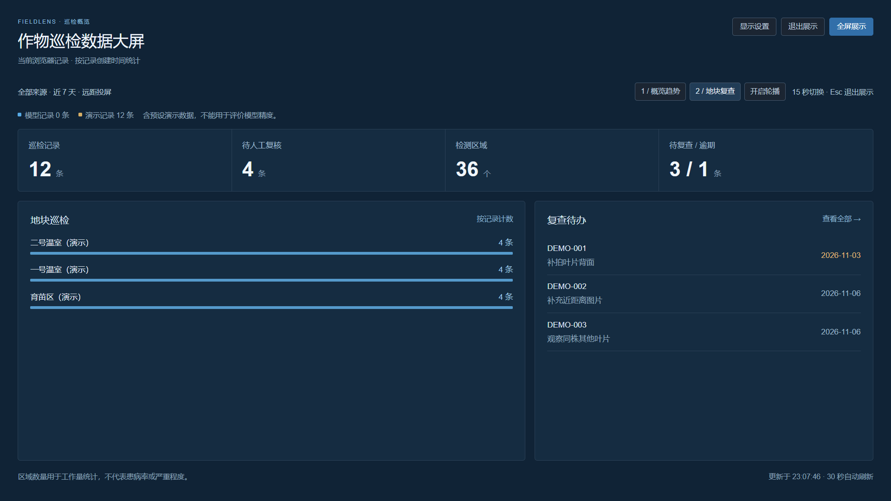
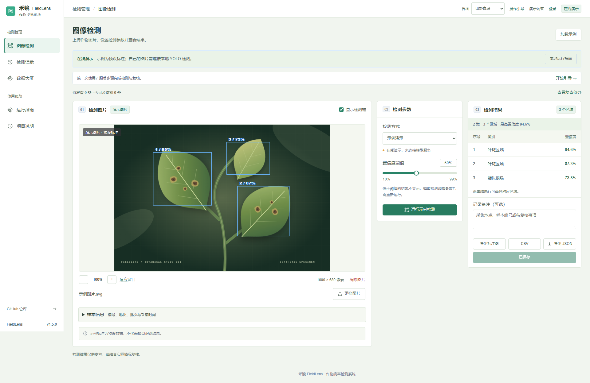
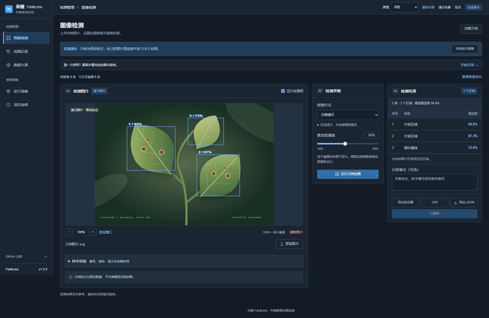

# 大屏视距与 UI 切换

v1.5，2026-11-04。适合日常桌面操作、教室投屏和会场展示。

## 如何使用

1. 右上角「界面」选择 **经典浅色 / 田野青绿 / 深色**。切换无需刷新，不会清空当前图片、输入或记录草稿。全屏大屏的设置区也保留同样入口。
2. 进入「数据大屏」，选择来源和近 7 / 30 天，再设置「观看视距」：标准适合桌面，远距放大标题、数字和图表文字，超远进一步放大并适配 4K。
3. 点击「专注展示」，隐藏应用导航和页头，保留统计指标。第一屏显示每日趋势与类别，第二屏显示地块与复查；可点按钮切换，也可开启 15 秒轮播。
4. 点击「显示设置」调整视距、来源、日期或主题；设置打开时暂不轮换页面。需要时点击「全屏展示」。Esc 或「退出展示」恢复正常操作；全屏也可通过其按钮退出。

视距是字号档位，不是对实际观看米数的保证。可按屏幕尺寸、分辨率与现场距离选择；小屏会限制字号，保持内容可读和退出入口可用。

## 设置与数据

主题、来源、时间范围和视距保存在当前浏览器。主题可在同源标签页之间同步，且不会重新渲染正在编辑的表单。浏览器禁止存储时，控制仍可在当前页面使用，但刷新后不保证记忆。

专注模式与轮播不会自动启动。轮播默认关闭，开启后每 15 秒切屏；暂停、退出或离开大屏都会清理相应状态。页面不可见、设置展开，或键盘正在操作图表明细时暂不切换。手动选屏会暂停轮播。

数据仍来自当前账号/访客的本机记录。自动数据刷新及另一标签页新增记录不会重置所选来源、日期、视距或专注状态；展开的每日明细保持展开。空数据不会被展示样例填充。

三种主题覆盖工作台、登录、管理表格、详情表单和引导弹窗；大屏继续采用适合展示的深色底，青绿主题增加田野色调。打印预览和 PDF 保持白底深色文字。

## 界面截图

其他尺寸：[4K 超远展示](presentation-4k.png) · [手机展示](presentation-mobile.png) · [深色手机工作台](theme-mobile.png) · [深色手机详情](theme-detail-mobile.png)。图中所有样例均为预设演示记录，不代表模型检测效果。

## 验证范围

27 项前端测试、生产构建和新增浏览器展示流程通过。三主题覆盖六个页面、三种宽度；展示覆盖 360px–3840px。验证了设置记忆、草稿保留、跨标签更新、轮播暂停、全屏进出、Esc、离页清理、存储受限和打印样式。

原有记录详情、人工复核、记录对比、报告导出和 AI 模拟流程完成回归。账号登录、YOLO 推理与通用 AI 接口继续保留；本轮没有修改后端协议。
