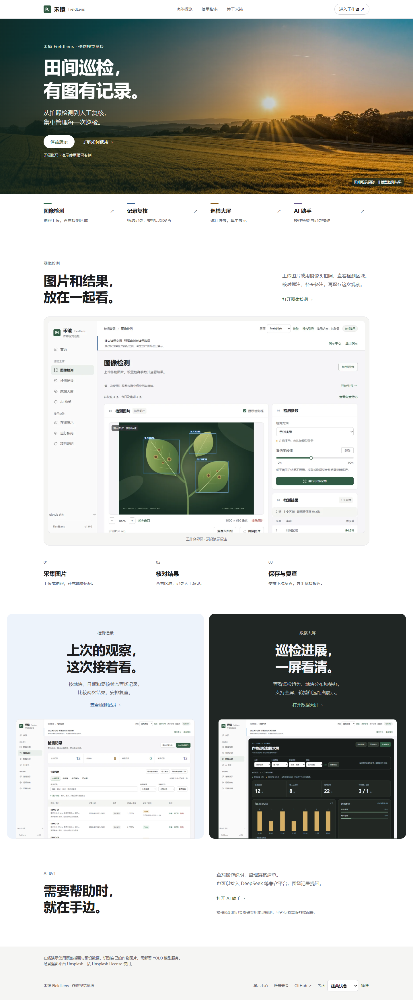

# 农业专业型界面

版本 1.9.0，2026-11-06（Asia/Shanghai）。

[产品首页](https://guhang2011.github.io/fieldlens/?v=1.9.0) · [直接体验检测](https://guhang2011.github.io/fieldlens/?demo=1&v=1.9.0#workspace)

## 参考与取舍

根据用户确认的方向，采用农业场景首页、清晰的业务布局与多色状态体系。先查看参考网站，再独立实现布局和样式。

| 参考 | 用在禾镜的部分 |
| --- | --- |
| [大疆农业](https://ag.dji.com/cn) | 农田主视觉、左侧文案、明确的功能入口与图文比例 |
| [Linear 产品规划](https://linear.app/plan) | 侧栏、列表、详情的层级；减少装饰性卡片和无效留白 |
| [Atlassian 色彩规范](https://atlassian.design/foundations/color/) | 信息、警告、完成状态的语义色，以及不同主题的对比度 |
| [Apple 中国官网](https://www.apple.com/cn/) | 字号层级与节奏；最终方向按用户选择调整为农业专业型 |

未复制上述网站的代码、标志、产品图片或字体文件。农田摄影另按 Unsplash License 使用，详见 [素材说明](../THIRD_PARTY_NOTICES.md)。原有示例叶片仍是原创插画，摄影不作为识别结果展示。

## 字体与颜色

- 工作页标题 28–30px；面板标题 16–17px；正文和主要操作 14–16px；表格主内容 14px；辅助信息 12–13px。
- 手机输入框使用 16px，兼顾阅读和系统自动缩放。表格在手机仍呈现为记录卡片。
- 青绿用于主操作，蓝色用于信息，橙色用于待复核/复查，绿色用于完成状态，紫色辅助区分演示统计。颜色同时配合文字标签，不能只凭颜色判断状态。
- 浅色、青绿、深色、暖砂和跟随系统继续可用。大屏的基础字体放大，保留三档视距、全屏与轮播。

## 首页和原有入口

公开站点无 hash 时显示产品首页；原 `#workspace`、`#history`、`#dashboard`、`#assistant` 等直达链接继续可用。带 `?demo=1` 且没有 hash 时进入演示中心。本地 API 模式的默认工作台/登录行为保留。

首页的“体验演示”打开独立演示空间；“进入工作台”打开当前工作空间。返回首页再进入工作台会保留未保存的工作台草稿。首页不主动写入演示记录，不启动摄像头或调用 AI。

## 验证

- 34 项前端单元测试和生产构建通过。
- 新增 `tests/browser/product-ui-workflow.js`：9 个页面 × 4 套主题 × 3 个宽度，共 108 组布局；检查首页入口、草稿保留、演示隔离、图片可用性、实际渲染字号、语义配色及减少动画设置。
- 既有检测、复核、备份、报告、详情键盘导航、AI 助手、换肤、摄像头、真实本地账号登录和大屏回归通过。摄像头与模型/AI 成功响应使用已有明确标注的测试替身；真实登录使用临时测试数据库。
- 大屏检查包含 4K 与远距；打印报告仍使用白底，不继承深色界面。
- 原工作流测试只把公开根入口改为明确的 `#workspace`；原断言保留。

新增页面图片使用 WebP。农田图片提供桌面/手机两种尺寸；三张业务截图延迟加载。没有增加运行依赖或外部字体请求。

[手机首页](product-home-mobile.png) · [手机记录页](product-records-mobile.png) · [AI 助手](product-assistant.png) · [深色助手](product-assistant-dark.png)
