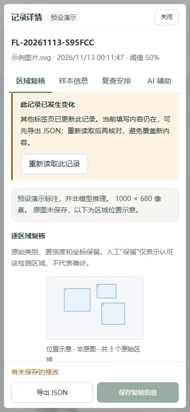
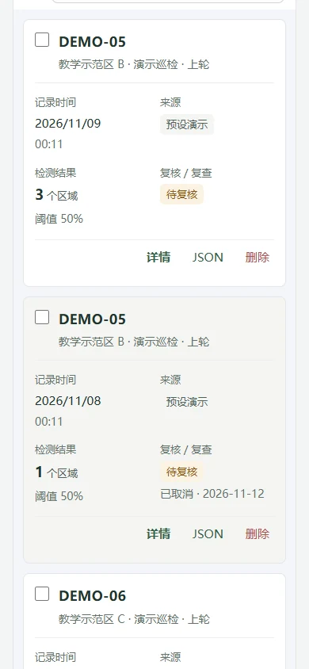

# v1.9.4 上线前修复记录

更新日期：2026-11-13。本次围绕实际操作中复现的问题调整，保留既有检测、复核、报告、摄像头、换肤、大屏和通用 AI 接口。

## 问题与处理

| 问题 | 修复后的行为 |
| --- | --- |
| 同一记录在两个标签页打开，旧详情保存会覆盖另一个页面的新意见 | 检测到其他标签页更新后同步列表，旧详情暂停保存，保留草稿。可先导出 JSON，再确认重新读取最新记录 |
| 记录已在另一页删除，旧详情仍可能提示保存成功 | 区分修改与删除，已删除的记录禁止保存，仍可导出当前填写内容 |
| 手机点击下一页后仍停留在列表底部 | 翻页后将焦点与滚动位置移到新列表，跨页勾选继续保留 |
| 冲突说明挤占小屏编辑区，横屏下提示被遮挡 | 提示进入可滚动的内容区；矮视口使用弹窗整体滚动，关闭、导出、重新读取和输入框可到达 |
| 登录代理返回 HTML 错误页时显示内部解析报错 | 显示中文服务异常提示，恢复登录按钮以便重试 |
| 离开登录页后，迟到的成功响应强行跳回工作台 | 离页取消等待，旧响应不再触发跳转 |
| 重新读取记录后，旧 AI 请求可能回写新面板 | 重建详情前清理旧实例，取消配置检查和回答等待，新的记录快照不会显示旧回答 |

## 本机验证

- 前端单元测试 34 项、后端测试 21 项通过，生产构建通过；`npm audit` 报告 0 项漏洞。
- 浏览器流程覆盖产品首页、字号与手机导航、筛选排序及勾选、备份、逐区域复核、报告、完整演示、助手、详情标签、换肤、合成摄像头、大屏与本次异常修复。
- 临时账号连接真实本机认证后端，验证登录、退出、401、会话过期、跨标签页退出、账号记录隔离，以及引导和大屏。
- 新增测试覆盖双标签页修改/删除、草稿导出、取消重新读取、搜索与选择保留、清空存储同步、分页焦点、非 JSON 登录响应、登录与 AI 迟到响应。临时反转冲突判定后，回归测试按预期失败；随后恢复代码并重新通过。
- 四套主题检查 1440×1000、390×844、320×568、844×390 浏览器视口。320×568 下冲突弹窗的内容区由约 43px 恢复到 233px。390×844 下翻到第二页时首条记录由视口上方约 1048px 调整到视口内约 24px。

以上为本机 Chrome 自动化与截图检查，不等同于实体手机兼容性或线上负载测试。摄像头使用合成媒体，AI 与检测接口使用明确标记的测试替身；未调用付费 AI，也未验证真实病害模型精度。





常用验证命令：

```sh
npm test
npm run build
npm audit
python -m unittest discover -s tests -p 'test_*.py' -q
```

浏览器场景位于 `tests/browser/`，其中 `release-readiness-workflow.js` 对应本轮修复。它需要提供静态构建站点与启用开发 API 的测试前端，接口异常由测试替身模拟。

## 发布范围

GitHub Pages 发布交互演示，无需账号密码。真实账号、YOLO 与平台 AI 需要自部署后端、授权模型及服务端配置；本次没有新增真实服务器部署。部署步骤见 [部署与 API](DEPLOYMENT.md) 和 [账号管理](ACCOUNTS_AND_SCREEN.md)。

记录仍保存在当前浏览器，最多 30 条，不包含原图，也不会跨设备同步。本轮防护处理已经观察到的其他标签页变更，localStorage 全量保存不提供数据库式原子并发保证。多人同时协作或长期保存应接入服务端记录库；现阶段可使用已有备份导出功能迁移记录。
