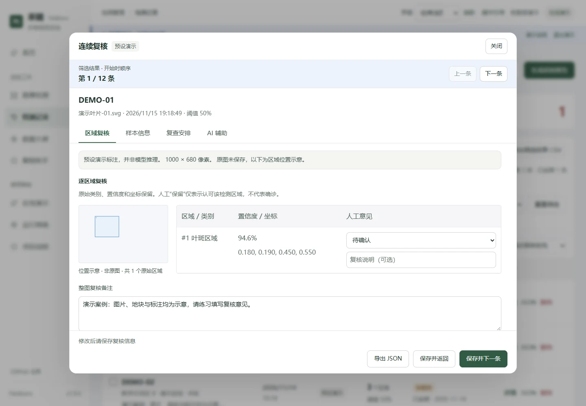
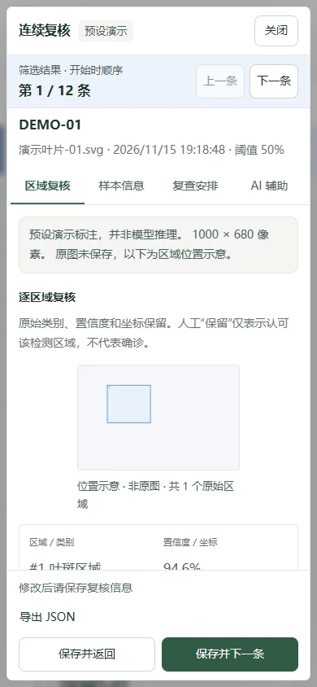

# v1.9.5 连续复核

更新日期：2026-11-15。

一批样本需要逐条核查时，以前每次保存都会关闭详情，再从列表寻找下一条。本版增加连续复核入口，可在同一弹窗中依次完成这批记录。

## 使用方法

1. 打开检测记录，按需要筛选、排序或跨页勾选。
2. 点击「连续复核」；有勾选时，按钮显示「复核所选」及数量。
3. 核对区域和备注，按实际情况勾选「已人工查看此记录」。使用「保存并下一条」继续处理；最后一条显示「保存并结束」。
4. 需要提前结束时，使用「保存并返回」。上一条和下一条只切换，不会自动保存。

## 操作边界

| 场景 | 行为 |
| --- | --- |
| 没有勾选 | 使用当前筛选结果及排序，包括其他分页中的记录 |
| 有勾选 | 只复核所选记录，遵循当前排序 |
| 已查看后不再满足“待复核”筛选 | 仍按开始时固定的顺序继续，不跳过下一条 |
| 其他标签页新增记录 | 不插入本次范围，重新开始时再选择 |
| 其他标签页删除后续记录 | 导航自动跳过已删除项，进度数字仍表示开始时的位置 |
| 当前记录被修改或删除 | 保留草稿并暂停保存，可导出、重新读取或手动切换 |
| 切换时有未保存修改 | 先确认是否放弃；取消后保留当前输入 |
| 校验不通过或保存失败 | 留在当前记录，显示提示并保留填写内容 |
| 切换时 AI 请求尚未完成 | 取消旧请求等待，旧回答不会写入新记录面板 |

保存不会自动标记“已人工查看”，也不会自动完成复查任务。单条详情的保存方式继续保留。关闭连续复核后，键盘焦点回到入口；当前筛选已无结果时回到搜索框。

## 界面

导航显示本次范围、开始时的位置和前后切换按钮。底部区分导出、保存返回、保存继续；手机上分行排列，横屏等矮视口使用弹窗整体滚动。沿用既有字号和四套主题，无新增运行依赖或字体下载。

## 验证与发布范围

前端单元测试、生产构建和浏览器回归覆盖现有记录、备份、报告、详情、演示、助手及主题功能。新增场景在 `tests/browser/review-queue-workflow.js`，检查实际保存结果、操作范围、草稿保护、跨标签页变化和迟到的 AI 响应。

- 前端单元测试 34 项、浏览器流程 13 组全部通过。
- 四套主题、六种视口共 24 组布局检查通过，无 JavaScript 错误；覆盖 320px 窄屏、手机横屏、平板和桌面。
- 临时反转队列导航条件后，新增测试按预期失败；恢复代码后回归通过。
- 生产构建成功：CSS 121.45 kB（gzip 22.98 kB），JavaScript 148.76 kB（gzip 49.66 kB）。相比 v1.9.4，压缩后合计增加约 0.97 kB；未引入新运行依赖。依赖审计未发现已知漏洞。

布局按 Chrome 浏览器视口检查，未作实体手机测试；AI 验证使用测试响应，未调用付费平台。公开站点继续提供无需账号的交互演示，真实登录和 YOLO 检测仍需自部署后端。记录仍存于当前浏览器，不跨设备同步；多标签页提示不提供数据库式原子并发保证。
