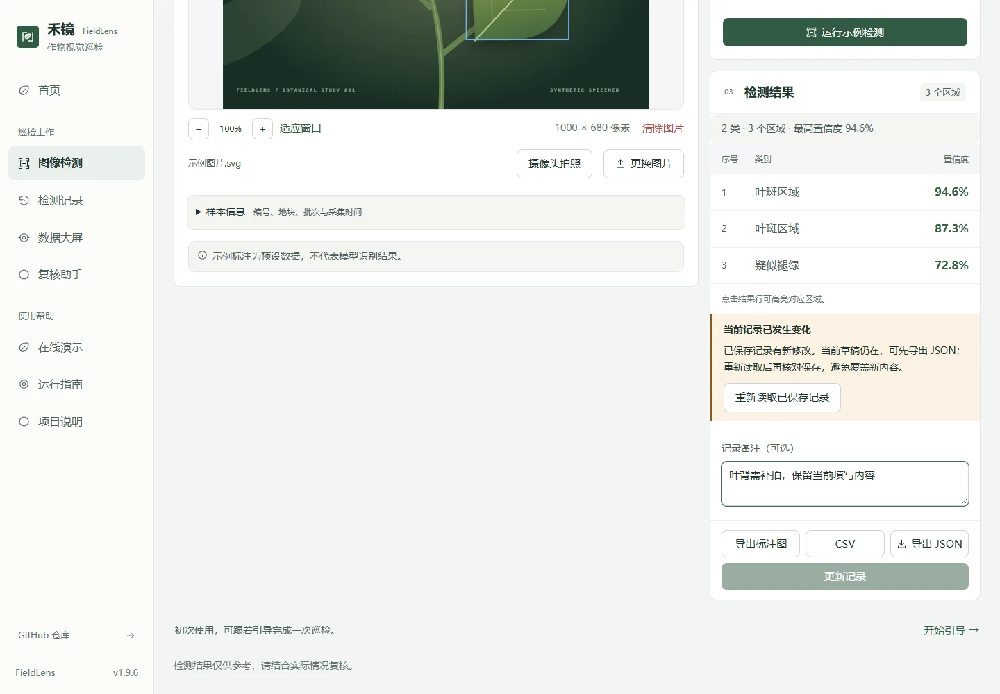
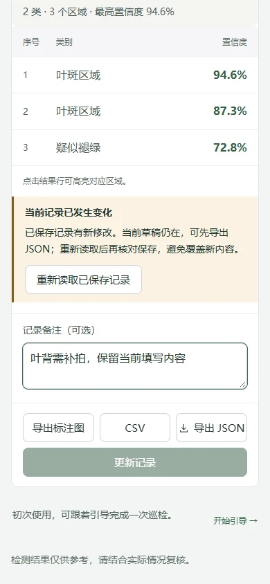
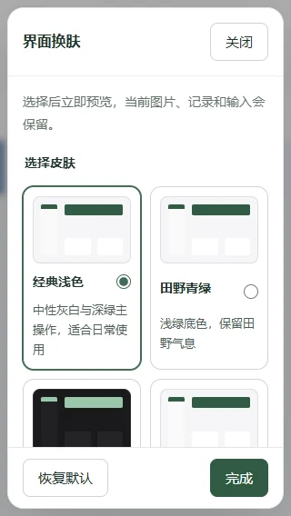

# v1.9.6 检查与修复

更新日期：2026-11-17。

本轮检查 v1.9.5 的现有操作，按数据保存、AI 异常、键盘及窄屏使用逐项复现并修复。没有新增模型服务、云端同步或运行依赖。

## 问题与处理

| 序号 | 已复现的问题 | 修复后的行为 |
| --- | --- | --- |
| 1 | 工作台保留旧备注时，另一标签页更新记录；随后在工作台修改地块并保存，会覆盖新备注。进入演示再返回、备份覆盖原始检测数据也存在相关路径。 | 显示冲突提示、保留草稿并暂停保存。可先导出，再确认重新读取。原始检测数据已更换时不允许只读取备注解除冲突；新检测单独保存。演示期间也追踪个人记录变化。 |
| 2 | 原生日期输入只删掉某一段时，浏览器暴露空字符串；保存误认为用户主动清空，丢失采集时间或复查日期。 | 区分“不完整”和“完整清空”。不完整时提示具体字段，保留输入，阻止保存、连续复核前进和工作台导出；修正后恢复正常。 |
| 3 | 从空浏览器恢复备份时，记录顺序反转。 | 新增记录按备份中的顺序放到现有记录之前，覆盖项保留原有位置。 |
| 4 | 修改备注并重新读取 AI 预览后，旧回答仍显示且可导出。 | 成功更新预览后清除旧回答及其来源，禁用旧回答导出。 |
| 5 | AI 代理返回 HTML 错误页、JSON null 或缺失字段时，页面出现英文内部错误。 | 显示中文异常提示，失败后可以重试；详情和独立助手共用修复。 |
| 6 | AI 请求里的超大整数触发数值转换溢出，后端返回 500 HTML。 | 阈值、置信度和坐标先校验数值范围，无效请求返回 400。 |
| 7 | AI 地址的端口不是数字、超范围或为 0，仍显示“已配置”。 | 配置检查提前判定无效，不再显示可调用状态。 |
| 8 | 大屏每 30 秒刷新内容后，“查看全部”等链接丢失键盘焦点。 | 刷新后恢复对应链接焦点，Enter 继续可用；每日明细的展开状态与焦点仍保留。 |
| 9 | 320px 窄屏中，换肤单选按钮覆盖说明文字。 | 单选按钮进入标题行的正常网格布局，不再依赖固定位置。 |
| 10 | 操作引导的关闭、定位按钮仍是 12px。 | 两类操作文字调整到 14px，并检查四主题、手机竖屏及横屏。 |

## 使用提示

工作台遇到冲突时，原有图片与填写内容仍在。先导出 JSON 可保留草稿；点击“重新读取已保存记录”会在确认后替换工作台样本信息和备注。如果记录已被删除，或备份恢复改变了原始检测数据，请导出当前草稿后重新检测，系统不会以旧结果覆盖新记录。

日期允许留空。只输入一部分日期属于不完整输入，需要补齐或完全清空后再保存。

## 修复截图

## 验证方式

本轮基线为 34 项前端单元测试、21 项 Python 测试通过。新增回归先在修复前失败，再确认修复后通过；保留原有测试。

- 前端单元测试增加完整备份恢复顺序和混合导入顺序检查，共 36 项。
- Python 测试增加大数值输入和非法端口检查，共 23 项。
- 新增浏览器流程：`workspace-reliability-workflow.js`、`native-date-workflow.js`、`assistant-reliability-workflow.js`、`ui-reliability-workflow.js`。包括真实同源标签页更新、演示往返、备份导入、原生日期分段编辑、AI 错误响应、键盘操作及文本重叠检测。
- 完整浏览器回归 17 组通过。新增界面验收包括 72 组引导布局，以及 4 主题 × 3 视口的 12 组工作台冲突提示检查。
- 对新端口校验条件进行临时反转，新增测试按预期失败；恢复后测试通过。
- 无新增依赖。依赖审计未发现已知漏洞。生产构建 CSS 121.52 kB（gzip 23.00 kB）、JavaScript 151.85 kB（gzip 50.51 kB）。单次构建时间不用于推断性能改善。

布局检查基于 Chrome 浏览器视口，未替代实体手机验收；AI 测试使用模拟响应，未调用付费平台。公开站继续提供免登录的预置交互演示。真实账号验证、YOLO 和平台 AI 需要自部署后端；本机记录没有跨设备同步，多标签页冲突提示也不提供数据库式原子并发保证。
