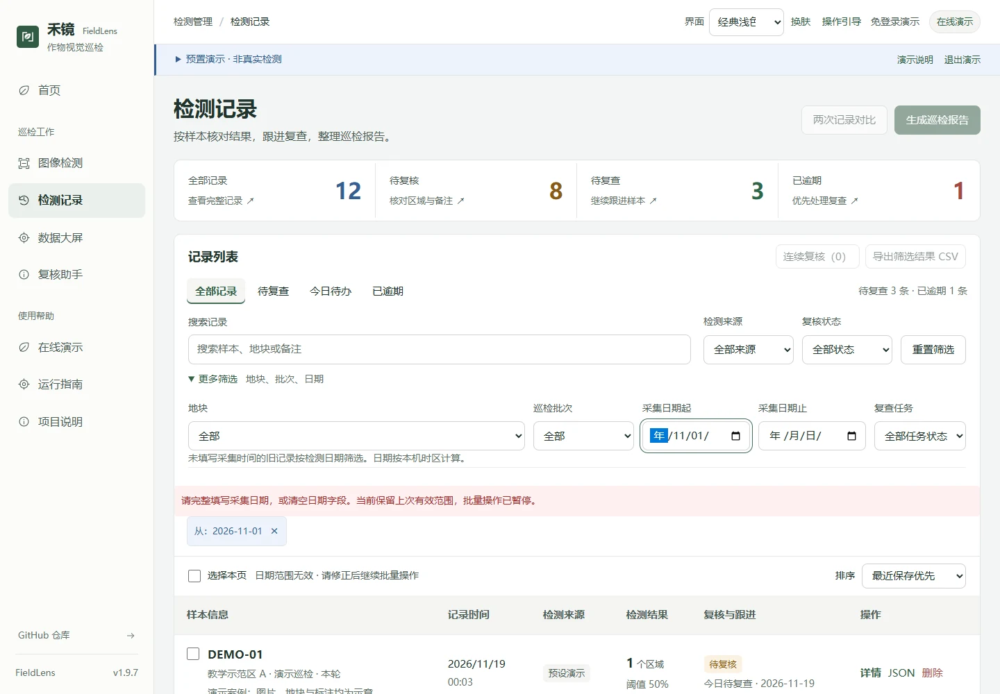
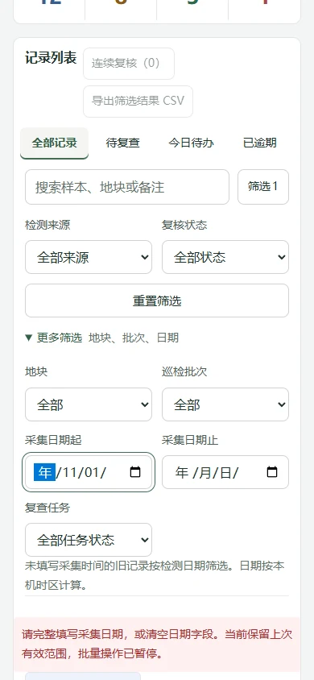

# v1.9.7 检查与修复

更新日期：2026-11-19。

本轮从检测、保存、筛选导出、备份恢复、登录退出和键盘操作逐项检查 v1.9.6。确认问题后先复现，再修复并回归原有流程。保留现有检测、复核、报告、大屏、换肤、摄像头和可选平台 AI 功能。

## 问题与处理

| 序号 | 已复现的问题 | 修复后的行为 |
| --- | --- | --- |
| 1 | 检测记录使用服务状态里的模型名，忽略检测响应中的实际模型；刷新服务状态还可能导致已完成结果出现错误的冲突提示。 | 保存实际检测响应的模型名；旧服务未返回模型名时，使用发起检测时的服务信息。后续状态刷新不会改动这一结果的来源。 |
| 2 | 检测服务返回 HTML、JSON null 或异常模型信息时提示不准确；读取响应期间取消可能显示连接错误。 | 区分响应格式异常、检测失败、超时和主动取消，显示中文提示；失败结果不可保存，恢复服务后可以重试。 |
| 3 | 多条记录包含大量区域复核说明时，系统自己导出的合法备份超过 5 MB，无法重新导入。 | 文件检查和解析使用相同的 64 MiB 上限，支持合法完整备份恢复；最多保留 30 条记录等约束继续生效。 |
| 4 | 原生日期只填一部分时，浏览器暴露空字符串，筛选误认为清空，可能扩大 CSV 或报告范围。 | 保留上次有效日期范围与勾选，提示补全或完全清空；暂停连续复核、CSV、报告和记录对比，修正后恢复。 |
| 5 | 畸形 Origin 请求头、账号或密码中的未配对 Unicode 字符触发服务器 500。 | Origin 解析失败返回 403 中文 JSON，非法账号或密码返回 400；正常中文密码仍可登录。 |
| 6 | 退出登录收到代理返回的 200 HTML 等异常响应时仍跳转，或失败提示直接暴露英文内部错误。 | 仅在成功状态且 JSON `ok === true` 时退出并通知其他标签页；失败、断网或超时保留页面、账号显示和草稿，允许重试。等待时禁用重复点击。 |
| 7 | 其他标签页更新记录后，当前列表的详情、JSON、删除等按钮丢失键盘焦点。 | 刷新后恢复同一记录的对应控件；记录消失时回到搜索框。搜索输入和已打开的详情不会被抢走焦点。 |
| 8 | 复核助手清除结果时，正在聚焦的按钮消失，键盘操作回到页首。 | 有记录时聚焦生成复核清单，无记录时聚焦生成巡检概览，可直接按 Enter 继续。 |
| 9 | 日期错误提示沿用 12px 浅红文字，手机阅读不清楚。 | 该提示调整为 14px，浅色、青绿、暖砂主题加深文字颜色，深色主题保留适配色，并检查四套主题下的阅读与布局。 |

日期筛选不完整时，仍可查看上次有效范围内的记录和调整勾选。批量操作恢复前必须补全日期或完全清空字段；系统不会把半填的日期自动理解成不限日期。

## 修复截图

截图拍摄于 2026-11-19，记录来自预置演示数据，展示日期不完整时的提示和暂停状态。

README 的主要业务截图仍标明拍摄于 v1.9.5；本轮没有把旧截图标为新版本拍摄。

## 验证

- `npm test`：37 项通过。新增最大合法备份在 UTF-8 编码及 JSON 转义后的恢复验证。
- 项目 Python 虚拟环境执行 `python -B -m unittest discover -s tests -p 'test_*.py' -q`：26 项通过。
- 浏览器完整回归 22 组通过，保留原有 17 组，新增检测可靠性、日期筛选、真实大备份往返、键盘焦点和注销可靠性 5 组。
- 新增回归先在修复前确认失败，再验证修复后通过。实际大备份测试导出超过 5 MB 的文件，清空后恢复 20 条记录和 6000 条区域说明，并核对顺序。
- 暂时禁用 Origin 拦截条件后，新增测试按预期失败；恢复实现后再次通过，确认测试能识别该回归。
- 日期提示覆盖四主题及 320、390、1440px 三个视口，12 组全部通过；字号均为 14px，浅色、青绿、暖砂文字对比度为 5.98:1，深色为 7.15:1。最后一项样式调整后，日期操作和产品界面两组浏览器流程再次通过。
- 独立代码审查未发现本轮引入的阻断问题。`npm run build` 成功，无新增运行依赖。

构建体积：CSS 从 121.52 kB（gzip 23.00 kB）变为 121.64 kB（gzip 23.03 kB）；JavaScript 从 151.85 kB（gzip 50.51 kB）变为 153.38 kB（gzip 51.09 kB）。增长来自错误处理、状态保护和焦点恢复；本轮不宣称构建性能提升。

浏览器验证使用 Chrome 与模拟服务响应，视口检查不替代实体手机验收；没有调用付费 AI 平台，也没有以模拟检测结果评估真实模型精度。

## 仍需了解的运行限制

AI 上游 30 秒超时是连接及读取空闲超时，**不是整次请求的总时限**。持续缓慢返回数据的上游可能占用单进程 AI 通道更久；浏览器 40 秒停止等待也不会终止服务端请求。本轮明确这一边界，未引入新的传输层实现。公开部署应选择具有总时限和费用限制的平台或网关，详见 [AI 平台接入](AI_PLATFORM.md)。

本轮依赖核验时，GitHub 已在 2026-11-18 15:38:56 UTC 撤回 [GHSA-fc5q-39xc-vjpf](https://github.com/advisories/GHSA-fc5q-39xc-vjpf)。已安装与 npm 最新的 picomatch 均为 4.0.7，没有已发布修复版本。全量 `npm audit` 当时仍报告由同一撤回公告传递到四个开发依赖的 4 项 high；`npm audit --omit=dev` 为 0。未将审计数据库的同步滞后表述为全量零告警，也未降级 Vite 或添加不必要的依赖覆盖。

GitHub Pages 继续提供免登录的预置交互演示。真实账号验证、YOLO 推理和平台 AI 需要自行部署后端；本次后端修复已包含在源码中，不表示公开静态站已部署这些服务。巡检记录仍保存在浏览器，没有跨设备云同步，多标签页冲突提示不提供数据库式原子并发保证。
