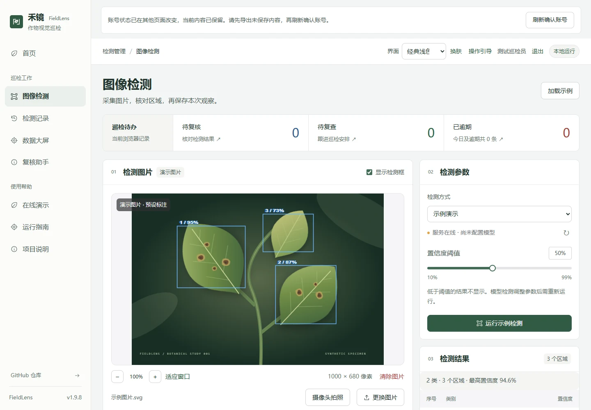
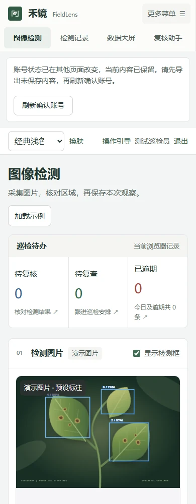
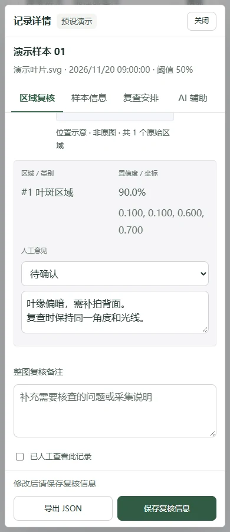

# v1.9.8 检查与修复

更新日期：2026-11-20。

本轮从 v1.9.7 继续检查工作台、演示入口、记录复核、操作引导和账号状态切换。以下七项均有复现步骤和对应修复，保留原有业务流程与测试。

## 问题与修复

| 序号 | 已复现的问题 | 修改后的行为 |
| --- | --- | --- |
| 1 | 检查模型连接会重建工作台。采集时间只填一部分时，检查完成会丢失未完整输入，以及此时继续填写的样本字段。 | 只更新服务状态、检测按钮和配置入口，保留样本表单、未完整日期、文字及展开状态。补全后可正常保存。 |
| 2 | 服务返回字符串 `ready: "false"` 或异常模型字段时，页面仍可能显示模型就绪。 | 校验就绪状态和模型字段类型、长度；异常响应按未连接处理，不能据此启用检测，正确响应后恢复。 |
| 3 | 首次打开演示中心，点击「体验复核助手」进入本机空记录空间，无法体验记录整理。 | 该入口与其他演示入口共用进入流程，载入独立演示案例；原有本机记录和工作台内容保留。本地服务模式仍直接进入本地助手。 |
| 4 | 引导定位到其他页面后关闭，原按钮已被移除，焦点回到页面主体；完成引导移除欢迎入口时也有相同问题。 | 原入口存在时返回原位置；原入口消失或完成后将被移除时，返回稳定的「操作引导」按钮，可继续键盘操作。 |
| 5 | 合法备份中的区域复核说明可以包含换行，但详情使用单行输入框，打开并保存后换行丢失。 | 改用默认两行的说明输入框，保留 300 字限制。导入、打开、保存、重新读取和再次导出均保留多行内容。 |
| 6 | 小于体积限制、但嵌套极深的 AI 请求 JSON 触发服务器 500。 | 返回中文 400 输入错误，不调用平台；随后正常请求仍可执行。 |
| 7 | 另一标签页登录或退出时，当前页自动刷新，工作台图片和未保存备注静默丢失。 | 保留当前内容并显示账号状态变化提示；暂停新服务请求与本机写入，取消正在等待的请求。允许先导出草稿，再确认刷新读取当前会话，避免将旧账号内容混入新账号。 |

## 账号变化时如何继续

收到账号变化提示后，当前图片、工作台备注、打开的记录详情和 AI 问题仍保留在页面中。需要保留的内容可先导出；点击「刷新确认账号」时再次确认是否刷新，取消不会清空草稿。

重新刷新后，页面从后端获取当前会话，并读取对应账号原有的本机记录。原账号记录不会自动转移。此保护只在已收到同源登录状态通知后生效；它不替代服务端鉴权，也不提供数据库式并发或跨设备同步。关闭页面仍会丢失未保存的临时内容，浏览器取消等待不保证后台请求已停止。

## 修复截图

以下截图拍摄于 2026-11-20。账号提示使用模拟测试账号，区域说明来自专用测试备份；均不作为真实模型检测效果证明。

README 主要业务截图仍注明拍摄于 v1.9.5，本轮修复截图单独展示。

## 验证范围

- 开工基线：37 项前端测试、26 项 Python 测试通过，生产构建成功。
- 修复后：37 项前端测试、27 项 Python 测试通过，生产构建成功。
- 浏览器回归：保留原有 22 组，新增服务状态、演示入口与引导、区域多行说明、跨标签会话变化四组，合计 26 组全部通过。
- 另运行 1 组真实后端认证流程，核对退出后接口返回 401、登录与会话过期恢复、账号记录隔离，以及新提示下的草稿保留和确认刷新；该组原有引导、大屏及 24 组响应式检查也通过。原测试中自动刷新预期随本次明确的交互变化调整，并增加草稿保留和真实会话撤销断言。
- 新缺陷先复现失败，再修复验证。将深层 JSON 异常处理临时替换为错误异常类型时，新增测试如预期失败；恢复实现后测试通过。
- 多行说明覆盖四套主题及 320、390、1440px 三种视口，验证文字换行、输入高度和无横向溢出；演示入口和引导检查手机与桌面操作。
- 会话变化测试采用独立标签页与模拟后端，核对草稿导出、请求与写入暂停、刷新取消和新旧账号记录隔离。
- 会话提示同样检查四主题及 320、390、1440px，共 12 组。正文、按钮均为 14px，各主题文字对比度均高于 4.5:1，没有横向溢出。
- 本轮未新增依赖，`npm audit` 报告 0 项告警；上轮已撤回公告的审计数据库同步问题已消失。

生产构建 CSS 为 122.12 kB（gzip 23.12 kB），JavaScript 为 154.81 kB（gzip 51.59 kB）。相较 v1.9.7，分别增加 0.48 kB 和 1.43 kB；增长来自会话保护、状态校验和相关界面处理。本轮没有以单次构建耗时声称性能改善。

浏览器验证基于 Chrome 和模拟服务，视口检查不替代实体手机、真实摄像头和真实付费平台验收。公开 GitHub Pages 继续提供免登录预置交互演示；真实账号、YOLO 推理与平台 AI 仍需要部署后端。

AI 上游仍使用连接及读取空闲超时，不是严格的请求总时限。该既有边界未在本轮改变，部署说明见 [AI 平台接入](AI_PLATFORM.md)。
