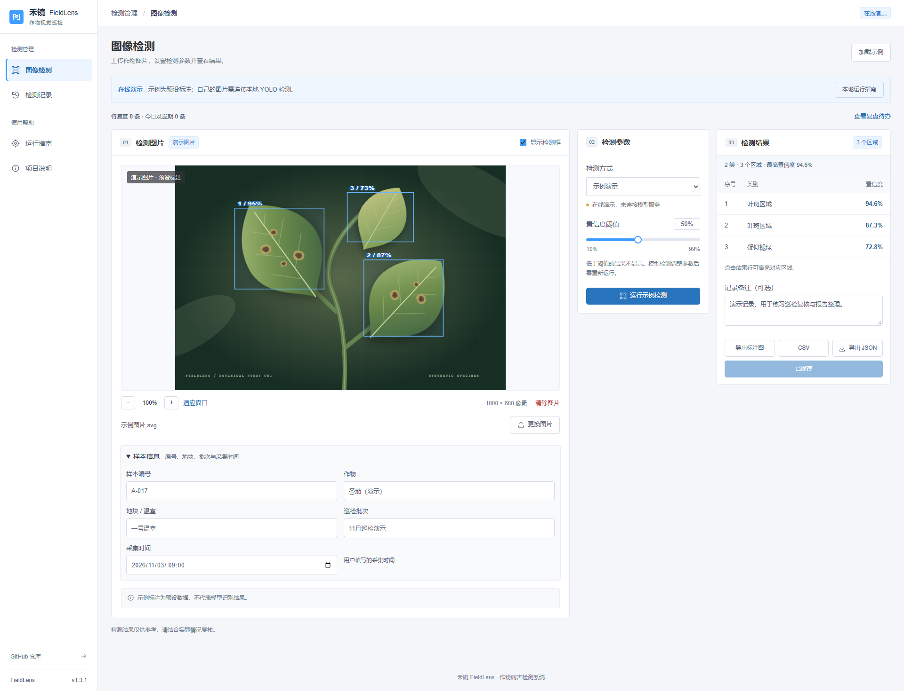
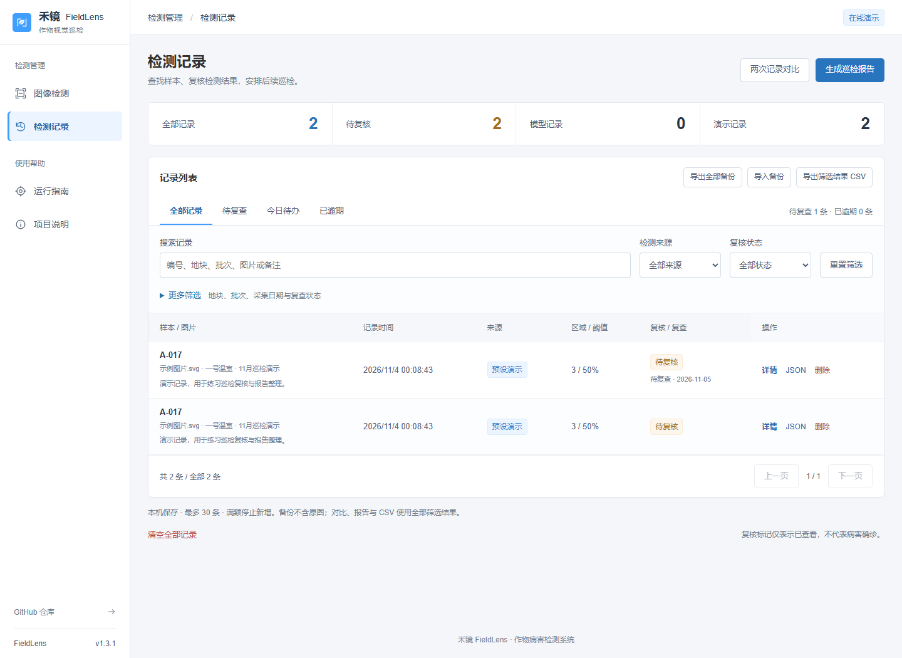
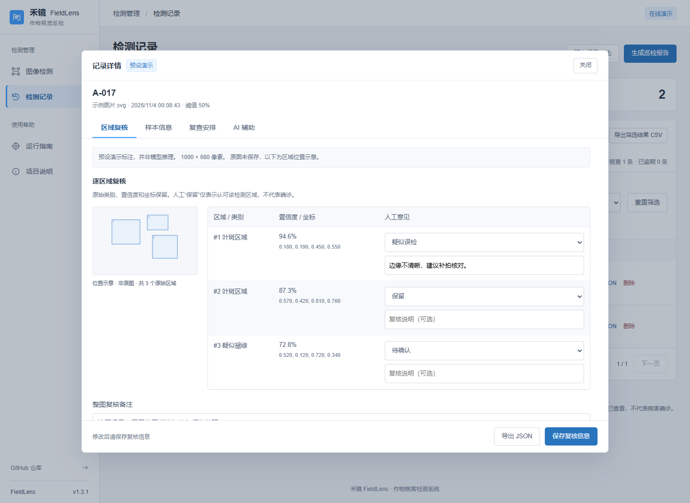
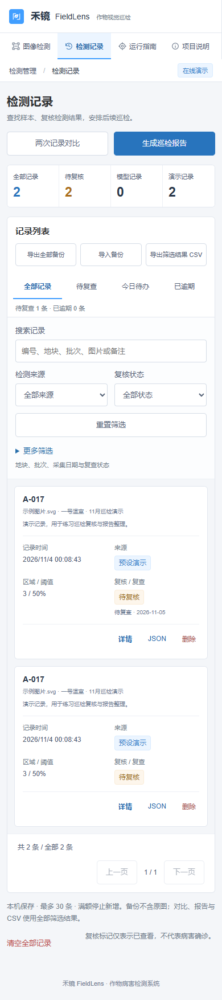
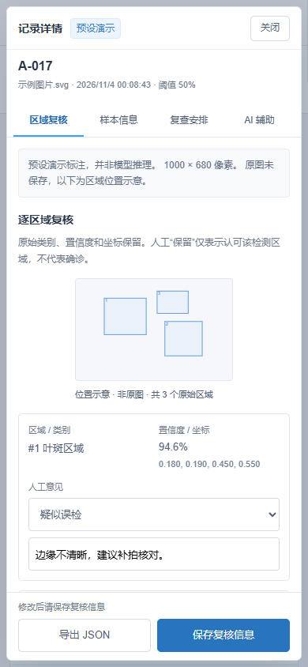

# v1.3.1 界面优化

日期：2026-11-04。继续采用 Element 风格的蓝色操作、浅色导航和标准表单，保留禾镜品牌与巡检流程。

## 使用问题与调整

| 问题 | 调整 |
| --- | --- |
| 工作台区块的操作顺序不明显 | 图片、参数、结果添加 01–03 分区编号，缩短提示，突出保存按钮 |
| 记录页的报告、对比和备份混在多个操作区 | 报告与对比放在页头，备份/恢复/CSV 集中到列表工具栏；复查快捷筛选采用下划线选中状态 |
| 手机表格需要反复左右滑动 | 650px 及以下改为记录卡片，时间、来源、区域、复核状态及操作直接显示 |
| 详情过长，复查和 AI 入口难找 | 分为区域复核、样本信息、复查安排、AI 辅助四个标签；打开 AI 标签自动展开辅助面板 |
| 切换内容后难确认是否保存 | 保留各分区的未保存内容，显示修改状态；校验失败自动打开对应分区 |
| 手机上的关闭和保存按钮容易滚出屏幕 | 固定详情页头、标签与底部保存区，内容区域独立滚动；扩大触摸按钮 |
| 区域示意与意见上下分离 | 桌面并排显示，手机改为区域卡片；始终标明“位置示意 · 非原图” |

标签可使用左右方向键、Home、End 操作。切换标签不会修改记录，只有“保存复核信息”会写入本地数据。YOLO、通用 AI 接口、备份、报告及记录格式保留兼容。

## 验证

- 25 项前端逻辑测试和生产构建通过。
- 原有三个浏览器流程通过：区域复核/对比/报告/模拟 AI、样本/复查/备份，以及跨页面草稿和异步完成保护。
- 4 个页面 × 6 种宽度（360、390、768、1440、1920、2560px）无页面水平溢出。
- 新增详情导航流程检查键盘焦点、切换保留草稿、错误跳转、跨分区保存，以及 4 个分区 × 4 种视口（最小 360×640）的固定操作区和内部滚动。
- 屏幕样式限定在 `@media screen`，报告打印布局继续通过检查。

运行浏览器流程前启动 `npm run preview -- --port 4176` 和 `npm run dev -- --port 5176`，使用 Playwright CLI 的 `run-code --filename tests/browser/detail-navigation.js` 等命令。界面截图只使用预设演示记录；AI 请求测试使用模拟平台，不代表真实检测或诊断效果。

## 截图

